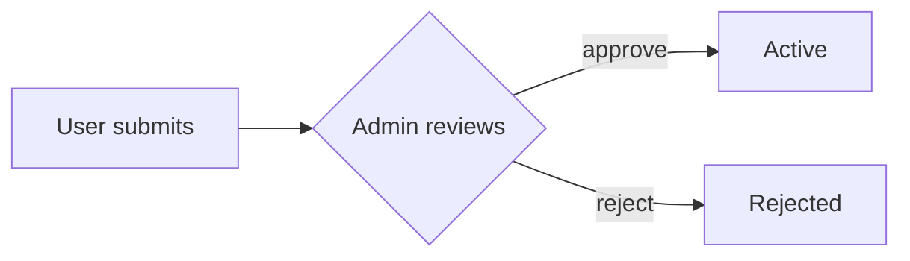

<!-- Copy into the right section (platform/, modules/<module>/, workflows/, roles/ — see README.md
     "Where does a doc go?") as <topic>.md. Fill in, delete this comment and any section that doesn't
     apply. Plain language, present tense, about one page. Add the doc to that folder's README index. -->

# <Topic>

**What it is.** One or two sentences a new team member understands without context.

**Who uses it.** Which app (manage / web) and which role(s).

## The flow

1. Step one: who does what, and what happens.
2. Step two.
3. …

<!-- Optional: a small diagram, e.g.

-->

## Rules

- The business rules: who may do what, limits, what happens on failure or cancellation.

## Where it lives

- **Module:** `apps/api/src/modules/<module>/`
- **Endpoints:** `GET /api/...`
- **Tables:** `...`
- **Screens:** which app and page

## History

- Planning files: [<date>-<slug>](../../planning/features/<date>-<slug>.md)  <!-- one more ../ per sub-folder level -->
