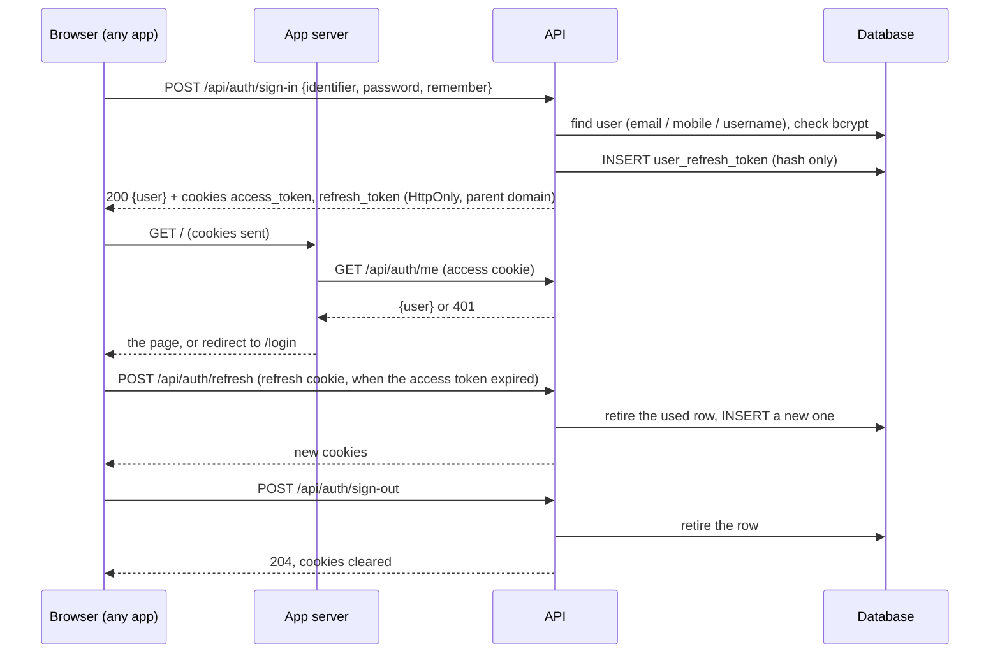

# Auth

**What it is.** Signing in and out, and knowing who is signed in: a user proves who they are with a username, email or mobile number and a password, and gets two tokens in cookies. **One session serves every app** (manage, web).

**Who uses it.** The login pages and signed-in areas of manage and web.

**Workflows:** none yet.

## The flow

1. **Sign-in** (`POST /api/auth/sign-in`, `{ identifier, password, remember }`), from manage or web only: the API knows the app from the `X-Client-App` header every app sends; any other caller → 422 `AUTH_APP_NOT_ALLOWED`. The identifier's shape says where to look: contains `@` → email (lower case); exactly 10 digits → mobile; else username. For manage, the user also needs an active Super Admin role, else 403 `CONSOLE_ACCESS_DENIED`.
2. **Every protected request** carries the access cookie and the calling app's `X-Client-App`. The API checks the token's signature and expiry and that the user is still active, then the route's own rule; the request's log lines carry the user id.
3. **Refresh** (`POST /api/auth/refresh`): when the access token has expired, the refresh token gets a new pair, and the used one is retired at once (rotation). A refresh token retired more than **30 seconds** ago is treated as stolen: every active refresh token of that user is retired (signed out everywhere). Two tabs refreshing at the same moment both succeed: the second gets `{ user }` and no new cookies.
4. **Who am I** (`GET /api/auth/me`): the signed-in user, or 401. `GET /api/auth/console-roles`: the user's console roles.
5. **Sign-out** (`POST /api/auth/sign-out`): retires the refresh token and clears both cookies (204), so every app is signed out.
6. **Change password** (`POST /api/auth/change-password`, `{ currentPassword, password, confirmPassword }`) for the signed-in person; a wrong current password → 422 `CURRENT_PASSWORD_INCORRECT` on `currentPassword`.
7. **Forgot password**, for any app (the link belongs to the app the request came from):
   - `POST /api/auth/forgot-password` `{ email }` → always 200 "If this email is registered, a password reset link has been sent to it." For an active user with that email: earlier links of that app are retired, a new token is stored (hash only, **60 minutes**, single use), and the [mail](../mail/README.md) module sends the `password_reset` template with the link `APP_URL_<APP>/forgot-password?token=…`.
   - `GET /api/auth/reset-password?token=…` → `{ maskedEmail }`, or 422 `RESET_LINK_INVALID`.
   - `POST /api/auth/reset-password` `{ token, password, confirmPassword }` → 204: the token is used, the password set, and every refresh token of the user retired.

## Rules

- **Tokens:** JWTs signed with HS256. Access token: `JWT_SECRET`, lifetime `JWT_EXPIRES_IN` (1 day). Refresh token: `JWT_REFRESH_SECRET`, `JWT_REFRESH_EXPIRES_IN` (30 days). The two secrets are required, at least 32 characters, different, never with a fallback.
- **Only hashes of tokens are stored** (SHA-256): `user_refresh_token`, `user_password_reset`, each with the app it was issued from (`client_app`, the API's `ClientApp` codes). Rows are never deleted: a used or revoked token gets `status = -1`.
- **Cookies, one pair for every app:** `access_token` (path `/`) and `refresh_token` (path `/api/auth`), with `AUTH_COOKIE_PREFIX` in front (`stag_` keeps staging apart from production on the same parent domain); `HttpOnly`, `SameSite=Lax`, `Secure` in production, `Domain` = `AUTH_COOKIE_DOMAIN`.
- **Errors:** an unknown user, a wrong password and a user without a password all answer 401 `INVALID_CREDENTIALS` with one message, so it does not reveal which accounts exist; an inactive user (after a correct password) 403 `ACCOUNT_INACTIVE`; a missing or expired token 401 `UNAUTHENTICATED`.
- **Password rules** (the same in the forms): 8–72 characters, the two passwords equal ("Passwords do not match.").
- **Users are read and created through the `users` module's service**; this module writes only `user_refresh_token` and `user_password_reset`.
- **Access** for every module's routes: `access.session` (any valid session), `access.signedIn` (signed in and allowed to use the calling app) and `access.roles([ids])` from `createAuthModule` ([route access](../../platform/route-access.md)); the signed-in user is then in `res.locals.authUser`.
- **Another tab changed the session:** a signed-in page sends `X-Session-User`; when it is not the cookie's user, the API answers 401 `SESSION_CHANGED` and the page goes to `/login`.
- **Audit** (module 2): 201 signed in, 202 sign-in failed (the identifier typed, never the password), 203 signed out, 204 tokens refreshed, 205 refresh token reused, 206–208 password reset requested / done / refused.
- No sign-up, email / mobile verification or rate limiting yet: a project adds them as features.

## Where it lives

- **Module:** `apps/api/src/modules/auth/`
- **Endpoints:** `POST /api/auth/sign-in`, `POST /api/auth/refresh`, `POST /api/auth/sign-out`, `GET /api/auth/me`, `GET /api/auth/console-roles`, `POST /api/auth/change-password`, `POST /api/auth/forgot-password`, `GET` / `POST /api/auth/reset-password`
- **Tables:** `user_refresh_token`, `user_password_reset` (migration `2026-10-28-users-and-auth.sql`); users in `user` ([users](../users/README.md))
- **Settings:** `JWT_*`, `AUTH_COOKIE_DOMAIN`, `AUTH_COOKIE_PREFIX`, `CORS_ORIGIN`, `APP_URL_MANAGE`, `APP_URL_WEB` in `apps/api/.env`
- **Screens:** `/login` and `/forgot-password` in manage and web; Change Password in the user menu

## History

- Planning files: [2026-10-28-starter-core](../../../planning/features/2026-10-28-starter-core.md), [2026-10-28-route-access](../../../planning/features/2026-10-28-route-access.md)
