# Gallery

**What it is.** A partner's photo galleries: a named set of photos for one of their parks (`gallery`, `gallery_photo`), sent to the Super Admin for approval and, once approved, attached to packages. The API module `apps/api/src/modules/gallery/`, mounted at `/api/gallery`. The process is in [WITW-Packages-Workflow](../../workflows/WITW-Packages-Workflow.md) §7, §11 and §12.6–12.7.

**Who uses it.** An **active partner** in the Partner portal (Gallery: the Approved, In Draft and Waiting for Approval tabs; add and edit a gallery) and the **Super Admin** in the console (Packages › Gallery Approvals and Galleries). The package module (Safari Packages Phase 5) reads the approved galleries and copies their photos.

## Statuses and the two photo sets

`gallery.status` (`GalleryStatus` in `types/gallery.types.ts`): 1 Draft, 2 Waiting for approval, 3 Approved, 4 Deleted by Super Admin, −1 Discarded. `gallery.has_approved_set` says the gallery has approved photos in use; `status` says where its **working copy** is.

Each gallery keeps up to two sets of photos in `gallery_photo` (`photo_set`): **1 approved** (in use: package pickers, the Approved tab) and **2 draft** (what the partner edits and what the Super Admin reviews).

```mermaid
stateDiagram-v2
    [*] --> Draft: partner creates
    Draft --> Waiting: send (needs a photo)
    Waiting --> Draft: partner moves it back
    Waiting --> Draft: Super Admin rejects (reason)
    Waiting --> Approved: Super Admin approves (draft set replaces the approved set)
    Draft --> Discarded: partner deletes (never approved)
    Approved --> Draft: partner edits (approved set copied into a draft set; the approved set stays in use)
    Draft --> Approved: partner deletes the draft of an approved gallery (title and photos restored)
    Approved --> DeletedBySuperAdmin: Super Admin deletes (reason)
```

- **Edit on an approved gallery** (`POST /galleries/:id/edit`, only status 3): status 1, the approved set is copied row by row into a new draft set (same file names), `approved_title` keeps the title in use, the reject reason is cleared. The approved set and title stay what packages and the Approved tab use until the draft is approved.
- **Delete** on a draft (`DELETE /galleries/:id`, only status 1): with an approved set, the draft set is marked −1, the title goes back to `approved_title` and the status to 3 ("Draft discarded. The approved photos are back."); never approved, the gallery becomes −1 and leaves every list ("Draft discarded.").
- **Approve** (only status 2): the old approved set is marked −1, the draft set becomes the approved set, `approved_title` = title, `has_approved_set` = 1, the reject reason is cleared, `decided_at` / `decided_by` set. "{title} is approved."
- **Reject** (only status 2): reason required, up to 512 ("Enter the reason." / "Use up to 512 characters."); back to Draft with the reason, shown on the partner's In Draft tab until the next approval or Edit. Rejecting the changes to an approved gallery keeps its `decided_at` / `decided_by` (the approval date the Approved on column and the PP7 side card show); a gallery never approved gets the rejection's. "Gallery rejected. It is back in draft with your reason."
- **Delete by the Super Admin** (a gallery with an approved set, status 1–3): reason required, up to 512; status 4 with `delete_reason`, `deleted_at` / `deleted_by`; it leaves the partner's Gallery and the package pickers. "Gallery deleted."
- The park is one value for the gallery (as on the board): changing it in a draft of an approved gallery shows at once, and deleting that draft restores the title and photos, not the park.
- Every transition is also a condition in the SQL (`WHERE status = …`), so a second click or a stale screen gets 409 (`GALLERY_NOT_DRAFT`, `GALLERY_NOT_WAITING`, `GALLERY_NOT_APPROVED`).

## Rules (portal)

- **Who:** every portal route needs a signed-in **active partner** (`partnerService.activePartnerOf(userId)`), else 403 `GALLERY_PARTNER_NOT_ACTIVE`; a gallery that isn't theirs, or is discarded or deleted by the Super Admin, is 404 `GALLERY_NOT_FOUND`. There are no foreign keys: the service checks every relation.
- **Title and park:** title required, up to 255 ("Enter the gallery title." / "Use up to 255 characters."); park required ("Choose the park.") and one of the partner's own **active** parks (`partnerService.parksOf(partnerId)`), else 422 `GALLERY_PARK_NOT_AVAILABLE` "This park is not available. Choose another park.".
- **Create** (`POST /galleries` `{ title, masterParkId }`): a Draft with no photos, "Gallery saved as a draft.".
- **Photos:** JPG, JPEG or PNG, checked from the file's bytes ("Choose JPG, JPEG or PNG files." `GALLERY_PHOTO_TYPE`); up to 8 MB each (`UPLOAD_REJECTED` "A photo is bigger than 8 MB."; the form names the file: "{file} is bigger than 8 MB."); no limit on the number, up to 20 per upload. Upload, replace and remove work only on a Draft, on its draft set.
  - Upload (`POST /galleries/:id/photos`, multipart field `photos`): added at the end of the draft set; the first photo of a set with no thumbnail becomes the thumbnail.
  - Replace (`PUT /galleries/:id/photos/:photoId/file`, field `photo`): the photo keeps its title, caption and place, with a new file.
  - Remove (`DELETE /galleries/:id/photos/:photoId`): never the thumbnail (409 `GALLERY_THUMBNAIL_REMOVE` "The thumbnail can't be removed.").
- **Save the draft** (`PUT /galleries/:id` `{ title, masterParkId, photos: [{ id, title?, caption? }], thumbnailPhotoId? }`): the board edits on the screen and saves once. The list is the draft set in its new order (title up to 255, caption up to 1,000); photos left out of it are removed; the thumbnail is `thumbnailPhotoId` (one of the listed photos, else 422 `GALLERY_THUMBNAIL_NOT_LISTED`) or the first photo; a draft with photos can't be saved with none, as that would remove the thumbnail (409 `GALLERY_THUMBNAIL_REMOVE`). A photo id that isn't in the draft set → 422 `GALLERY_PHOTO_NOT_FOUND`. "Gallery saved as a draft."
- **Send** (`POST /galleries/:id/send`, Draft only): needs at least one photo (422 `GALLERY_PHOTOS_REQUIRED` "Add at least one photo first."); status 2, `sent_at`; every active Super Admin gets the in-app notification **1101** (`NotificationKind.GALLERY_SENT`, console, entity = the gallery, actor = the partner's user, subject = the gallery title, actor name = the partner's business name). "Gallery sent for approval."
- **Move back to draft** (`POST /galleries/:id/move-back`, Waiting only): "The gallery is back in draft."
- **Lists** (`GET /galleries?tab=approved|draft|waiting`): `{ tab, items, counts }`. Approved = galleries with an approved set (they may also be in In Draft or Waiting when a draft is open: `status` tells which); In Draft = status 1; Waiting = status 2. Each item has the title, `approvedTitle`, park, status, `hasApprovedSet`, reject reason, and the photo count and thumbnail of the set the tab shows (approved set on Approved, draft set on the others). `GET /galleries/:id` gives both sets (`approvedPhotos`, `draftPhotos`) with each photo's title, caption, order, thumbnail flag and `fileVersion`.

## Rules (console)

- `GET /admin/approvals` (Gallery Approvals): Waiting galleries, oldest sent first; `GET /admin/galleries` (Galleries): galleries with an approved set, newest approved first. Both search the title, approved title and business name (`search`) and page (`page`, `limit`). Each item adds the partner; `hasApprovedSet` gives the kind: "New gallery" (false) or "Edit of an approved gallery" (true).
- `GET /admin/galleries/:id`: the gallery with both sets (View photos shows the draft set for a waiting gallery, the approved set on Galleries).

## Screens

- **Partner portal** (`apps/partner`): `/gallery` (PP6: Approved / In Draft / Waiting for Approval tabs, `?tab=`), `/gallery/new` and `/gallery/<id>` (PP7). A new gallery is saved as create, upload, save; photos added to a saved draft and Replace reach the API at once, Remove, order, titles, captions and the thumbnail are saved with Save draft. The page is read-only unless the gallery is a draft.
- **Console** (`apps/manage`): `/gallery-approvals` (PC7: View photos, Approve, Reject with reason) and `/galleries` (PC8: View photos, Delete with reason), both searchable and paged. The notification kind 1101 in the bell and on Notifications links to Gallery Approvals.

## Photo files

- Stored at `gallery/<gallery id>/<file>` through `fileStorage`; the rows keep only the file name. **Gallery files are never overwritten or deleted:** every upload and replace writes a new file name, a removed photo keeps its file, and a draft set made by Edit points at the same files as the approved set. So no change to a gallery can break a set, an approved gallery or a package copy.
- Files are written before the transaction that adds their rows; if the transaction fails, the files just written are removed and the failure is audited.
- Shown only through the API (`sendInline`, private): `GET /galleries/:id/photos/:photoId/file` for the owning active partner, `GET /admin/galleries/:id/photos/:photoId/file` for the Super Admin. The website never reads gallery files: a package shows its own copies (below).

## For other modules

`galleryService` from `createGalleryModule` (used by the [package](../package/README.md) module):

- `approvedGalleriesOf(partnerId)`: the partner's galleries with an approved set and not deleted (id, approved title, park, photo count, thumbnail photo id), by title: the PP5 pickers (any park).
- `approvedCopyOf(partnerId, galleryId)`: the approved title and the approved photos (file name, title, caption, order, thumbnail); 404 `GALLERY_NOT_FOUND` for another partner's gallery, one never approved, or one deleted.
- `photoContent(galleryId, fileName)`: a photo file's bytes.

**Package copies:** when a package section with a gallery is saved, the package module takes `approvedCopyOf`, reads each file with `photoContent` and writes it into the package's own folder (`package/<package id>/<version>/…`) before its transaction, then stores the rows in `package_version_photo`. A package never points at gallery files, so later gallery edits, approvals or a Super Admin delete reach it only when the package is saved and approved again (workflow §7.2).

## Audit

Module 11, entity 14 (`AuditEntity.GALLERY`): 1101 created · 1103 draft saved · 1105 photos added · 1107 photo replaced · 1109 photo removed · 1111 sent · 1113 moved back · 1115 edit started · 1117 draft deleted · 1119 approved · 1121 rejected · 1123 deleted by Super Admin · 1125 / 1127 demo data added / removed · 1129 `ct_` test data removed (`test-data/remove-ct`, see [browser testing](../../platform/browser-testing.md)); each failure is the next number.

## Routes

| Route | Access |
|---|---|
| `GET` / `POST /api/gallery/galleries`, `GET` / `PUT` / `DELETE /galleries/:id`, `POST /galleries/:id/send`, `/move-back`, `/edit`, `POST /galleries/:id/photos`, `DELETE /galleries/:id/photos/:photoId`, `GET` / `PUT /galleries/:id/photos/:photoId/file` | signed-in (an active partner, checked by the service) |
| `GET /api/gallery/admin/approvals`, `GET /admin/galleries`, `GET /admin/galleries/:id`, `POST /admin/galleries/:id/approve`, `/reject` `{ reason }`, `/delete` `{ reason }`, `GET /admin/galleries/:id/photos/:photoId/file` | Super Admin |

## Demo data (local only)

`npm run cli packages-demo/add <password> confirm` also adds the prototype's six sample galleries for the two active demo partners, with photos from `apps/api/seed/packages-demo/gallery/` (copied from the prototype's images): Saccharum Safari Lodge (Jungle Trails, approved), Corbett Elephant Camp (Jungle Trails, approved with changes waiting), Jhalana Hills (Jungle Trails, waiting), Bandhavgarh Zones (Jungle Trails, in draft with a reject reason), Antara Cruises Catamaran (Tiger Trail, approved), Kuno Grasslands (Tiger Trail, waiting). A gallery is found again by its partner and title, so running it again adds nothing. `packages-demo/remove confirm` removes the demo partners' galleries, their photo rows and their folders `gallery/<id>/` in storage. The demo packages find the approved galleries' ids through `galleryDemoService.galleryIdsOf(partnerIds)`.

## History

- Planning file: [2026-11-12-safari-packages](../../../planning/features/2026-11-12-safari-packages.md)
