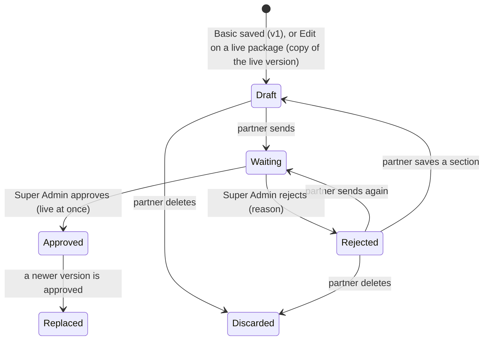

# Package

**What it is.** Partners' safari packages, kept as numbered versions that the Super Admin approves (`package`, `package_version` and its children `package_version_park`, `_feature`, `_inclusion`, `_day`, `_faq`, `_photo`), the Package Delete Reasons master (`master_package_delete_reason`), and the one rule that decides whether a package is shown on the website. The API module `apps/api/src/modules/package/`, mounted at `/api/package`. The process is in [WITW-Packages-Workflow](../../workflows/WITW-Packages-Workflow.md) §4–§6, §8, §11 and §12.3–12.5.

**Who uses it.** An **active partner** in the Partner portal (Dashboard, Packages, Add / Edit package), the **Super Admin** in the console (Packages › Package Approvals, Packages, Package preview / edit, Package Delete Reasons), **anyone** on the website (package list and page), and other modules through `packageService` (quote requests, the park pages).

## A package and its versions

`package` holds what never changes between versions: the partner, the `slug` (made from the first name, never changed), `website_status`, Popular, Best deal, the first approval date and the Super Admin's delete. Everything the package shows lives in a `package_version` row: v1, v2 … each a full copy of the five sections.

`package_version.status` (`PackageVersionStatus`): 1 Draft, 2 Waiting for approval, 3 Rejected, 4 Approved (live), 5 Replaced, −1 Discarded.

- **At most one live and one working version.** The generated columns `live_version_key` (status 4) and `working_version_key` (status 1–3) carry unique keys, so the database refuses a second one even under a race; code never writes them, and reads join on them (`live.live_version_key = package.id`).
- **Every transition is a condition in the SQL** (`WHERE status IN (…)`); a second click or a stale screen gets 409 (`PACKAGE_VERSION_NOT_EDITABLE`, `PACKAGE_VERSION_NOT_WAITING`, `PACKAGE_WORKING_VERSION_EXISTS`, `PACKAGE_NOT_LIVE`, `PACKAGE_DELETED`).
- **Saving a section** first "touches" the version in SQL: the partner's touch sets status 1 where it is 1 or 3 (so a Rejected version becomes a Draft; its reject reason stays as history); the Super Admin's touch sets `admin_edited_at` / `admin_edited_by` where the status is 2 or 4. Nothing else changes when the touch finds no row.
- **Edit on a live package** (`POST /portal/packages/:id/edit`): only with a live version, no working version and the package not deleted. The next number is a Draft copy of the live version (all five sections, parks, features, inclusions, days, FAQs and gallery copies); the files the live version uses are copied first into the new version's folder. "A new draft is made from the live version."
- **Send** (Draft or Rejected): status 2, `sent_at`; every active Super Admin gets notification **1201** (below). "Version {n} sent for approval." Only Basic must be saved, and it always is (the version exists from Basic).
- **Delete** the working version (Draft or Rejected): status −1, `deleted_at` / `deleted_by`. A package never live then gets website status −1 and leaves every list ("This draft will be discarded." · "Draft discarded.").
- **Approve** (Waiting, package not deleted), in one transaction: the old live version becomes 5 (`replaced_at`), then the waiting one becomes 4 (`decided_at` / `decided_by`), then the package: website status Active, Popular cleared, `first_live_at` set on the first approval. "{name} v{n} is live on the website."
- **Reject** (Waiting): reason required, up to 512 ("Enter the reason." / "Use up to 512 characters."); status 3 with the reason. "Version {n} rejected. The partner sees the reason."
- The partner is **never notified** of approvals, rejections, Super Admin edits or deletes: they see them on the package.

## Website status

`package.website_status` (`PackageWebsiteStatus`): 1 Not live yet, 2 Active, 3 Inactive, 4 Deleted by Super Admin (final), −1 Discarded (never live; out of every list).

- **Partner** (`PUT /portal/packages/:id/website-status` `{ websiteStatus: 2 | 3 }`): only with a live version and not deleted; at once, no approval. "{name} is now active / inactive on the website."
- **Super Admin delete** (`POST /admin/packages/:id/delete` `{ masterPackageDeleteReasonId, details }`): only a live package (Active or Inactive); an **active** reason ("Choose a reason.") and details up to 1,000 ("Enter the details."); status 4, Popular cleared, the reason's id and its name at that moment (`delete_reason_name`), the details, `deleted_at` / `deleted_by`. Final: no edit, send, approve or status change after it; the partner sees it View only with the reason.
- **Popular** / **Best deal** (`PUT /admin/packages/:id/popular` / `best-deal` `{ on }`): only a live package not deleted. Every approval clears Popular.

## Shown on the website (one place)

A package is shown only when it has a **live version**, its website status is **Active** and its **partner is Active**. This is written once: `SHOWN_FROM` / `SHOWN_WHERE` in `sql/package-website.sql.ts` (join on the live version and the partner) with the values `SHOWN` from `services/package-rules.ts`, and `isShown(row)` there for a row already loaded. Every website read and every `packageService` method uses it, so a partner deactivated in the console hides all their packages at once with nothing written to the packages.

- **Never approved** (`first_live_at` empty, or an unknown slug): `GET /packages/:slug` answers 404 `PACKAGE_NOT_FOUND` (the page sends the visitor home).
- **Approved before but not shown** (Inactive, Deleted by Super Admin, or partner Inactive): 200 `{ inUse: false, package: null }` ("Package Not In Use!").

## Sections and their rules (portal and console)

The partner saves the working version (Draft or Rejected); the Super Admin saves the waiting or the live version (all five sections, the plan's Q3). Both use the same editor (`services/package-editor.ts`), so the rules are the same. Messages are the boards' (`PACKAGE_MESSAGES` in `validators/package.validators.ts`).

- **Basic** (`POST /portal/packages` creates the package with v1 Draft, "Basic saved. Version 1 is a draft; the other sections are open now."; `PUT …/versions/:versionId/basic` saves it again): name up to 215; parks 1+ of the partner's own **active** parks (a park already on the version may stay after it is made inactive), the first is the main park (`sort_order` 0); days 1–15 (nights = days − 1); safaris 1–99; safari type, vehicle, theme, stay from the code lists; features optional; start / end place letters, spaces and hyphens, up to 215; price per person and total 1,000–99,99,999 whole rupees, total ≥ price per person, price before discount optional and > price per person; activity message, price message, tag up to 255; tag colours `#RRGGBB` (default `#C0392B` / `#FFFFFF`); one approved gallery or none; overview up to 2,000.
  - **Fewer days:** when the new day count is below a saved day, the save is refused (409 `PACKAGE_DAYS_REMOVAL_UNCONFIRMED`) unless the body has `confirmDayRemoval: true` (after the screen's "Remove days X–Y?"); then the days above the count and their gallery copies get status −1.
- **Itinerary** (`PUT …/itinerary` `{ days: [...] }`): exactly one block per day, numbered 1…days; title (255) and description (2,000) required; start, end, hotel up to 255; activity, accommodation, note up to 500; the three meals; one approved gallery or none per day. A day keeps its image.
- **Inclusions** (`PUT …/inclusions`): each of the six inclusions exactly once, Included or Not included; more inclusions and exclusions up to 512. When **Meals changes to Included**, every day's breakfast, lunch and dinner are ticked and the answer says `mealsTicked: true` (toast "… Breakfast, lunch and dinner are ticked on every day."); saving again with Meals still Included leaves the days as the partner set them.
- **Getting there** (`PUT …/getting-there`): up to 2,000. **FAQs** (`PUT …/faqs`): the whole list in order (question up to 512, answer required); the old rows get status −1.
- Each section save answers `{ package, version, mealsTicked }` and "Section saved." ("Saved. The website shows the change now." when the Super Admin saves the live version).
- **Images**: package and banner (`PUT` / `DELETE …/images/package|banner`, field `image`) JPG, JPEG or PNG up to 250 KB ("Choose a JPG, JPEG or PNG file." / "Choose a file up to 250 KB."); day image (`PUT` / `DELETE …/days/:dayNumber/image`) JPG, JPEG or PNG of any size (the API stops at 20 MB), on a saved day only. The type is checked from the bytes. The form saves the section first, then sends the images.
- **Relations are checked in the service** (there are no foreign keys): the package is the partner's own (else 404), the parks are the partner's, the galleries are the partner's approved ones (`galleryService.approvedCopyOf`, else 422 `PACKAGE_GALLERY_NOT_AVAILABLE` "Choose one of your approved galleries."), the delete reason is active.

## Gallery copies and files

- Files live at `package/<package id>/<version number>/<file>` through `fileStorage`; rows keep only the file name. Package, banner and day images get a new random name on each upload; nothing is overwritten or deleted.
- **A gallery is copied when its section is saved**: `approvedCopyOf` gives the approved photos; each file is read with `galleryService.photoContent` and written to the version's folder as `g<gallery id>-<gallery file name>` **before** the transaction (only files the version doesn't have yet); then the transaction replaces the version's (or the day's) rows in `package_version_photo` and the gallery id and title. If the transaction fails, the files just written are removed. Later gallery changes reach the package only when it is saved (and, for the partner, approved) again.
- A version's files are served only if the version uses them (its images, its days' images, its active photos): `GET /portal/…/files/:fileName` (own package), `GET /admin/…/files/:fileName` (Super Admin), `GET /packages/:slug/files/:fileName` (public, the live version of a shown package only).

## Lists

- **Portal** (`GET /portal/packages?search=&websiteStatus=`): the partner's packages (not discarded), newest change first; each with the name and parks of the working version (else the live one), `live` / `working` (id, number, status), website status, `updatedAt` and **`actions`** from workflow §6.2: Deleted → `view`; not live with a waiting version → `view`; not live with a draft or rejected one → `edit`, `send`, `delete`; live with a waiting version → `view`, `makeInactive` / `makeActive`; live with a draft or rejected one → `edit`, `send`, `deleteDraft`, toggle; live only → `edit` (makes a new version), toggle.
- **List pictures:** every portal and console list item carries `shownVersionId` (the version the row shows: portal working first, console live first), its `packageImage` and `mainPark` (id, slug, feature image); dashboard items carry `liveVersionId`, `packageImage`, `mainPark`; approval items the waiting version's `packageImage` and `mainPark`. The screens show the package image through the version's file route, else the main park's feature image, else the default picture.
- **Portal package** (`GET /portal/packages/:id`): `{ package, version }` with the working version (else the live one); `GET …/versions/:versionId` any version (a Replaced one comes with `canEdit: false`). `package.versions` lists every version with its dates (made, sent, decided, replaced, deleted, edited by Super Admin) and reason.
- **Dashboard** (`GET /portal/dashboard`): the latest two Active packages (by approval) with name, parks, days / nights, price per person and live version. The Dashboard's quote count is the quote-request module's `GET /api/quote-request/portal/summary` (the package module doesn't read quote requests).
- **Form options** (`GET /portal/form-options`, `GET /admin/packages/:id/form-options`): the partner's active parks and approved galleries (any park).
- **Package Approvals** (`GET /admin/approvals?search=&page=&limit=`): waiting versions of packages not deleted, oldest sent first; search the version name or business name; each with the parks, partner, version number and `liveVersionNumber` (null = "First version", else "Live now: vN").
- **Packages** (`GET /admin/packages?search=&websiteStatus=2|3|4&partnerId=&page=&limit=`): live and deleted packages, newest first live first; name and parks of the live version, partner (with `isActive`, "Hidden: partner inactive"), Popular, Best deal, website status, actions (`view`, `edit`, `delete`; deleted: `view`). `GET /admin/packages/:id` the summary with every version; `GET /admin/packages/:id/versions/:versionId` a version (preview / edit).
- **Website** (`GET /packages`): shown packages, 12 per page (`page`, `hasMore`), filters `search` (name), `masterParkId` (any of the version's parks), `priceMin` / `priceMax` (₹50,000 or more = no upper limit), `nightsMin` / `nightsMax` (10 or more = none), `safarisMin` / `safarisMax` (10 or more = none), `stays`, `features`, `inclusions` (comma lists; any match; an inclusion counts when Included); `sort` `popular` (default: Popular first, then newest), `newest`, `fewest-safaris`, `most-safaris`, `price-low`. Each card: slug, name, main park (with its slug and feature image for the fallback picture), parks, days / nights, safaris, activity message, prices, price message, tag, package image, Popular, Best deal, partner. `GET /packages/:slug` adds the full live version (banner, vehicle, stay, theme, places, gallery, days with their galleries, inclusions, getting there, FAQs).

## Package Delete Reasons

`master_package_delete_reason`: name up to 100 ("Enter the reason." / "Use up to 100 characters."), unique ignoring case ("This reason already exists."), `status` 1 Active / 2 Inactive (`DeleteReasonStatus`), listed by id with `usedCount` (packages deleted with it). `GET /admin/delete-reasons?search=&status=&page=&limit=`, `GET /admin/delete-reasons/active` (the Delete dialog), `POST /admin/delete-reasons` `{ name }` ("Reason added.", Active), `PUT /admin/delete-reasons/:id` `{ name, status }` ("Reason updated."), `PUT /admin/delete-reasons/:id/status` `{ status }` ('Reason "{name}" is now active / inactive.'). No delete. A deleted package keeps the reason's name as it was.

## Notification 1201

Send notifies every active Super Admin: `NotificationKind.PACKAGE_VERSION_SENT` (1201), console, entity = the package (`AuditEntity.PACKAGE`, the package id), subject = "<name> (v<n>)", actor = the partner's account with **actor name = the business name** (stored on the notification, see [notification](../notification/README.md)): "Jungle Trails Safaris sent Corbett Elephant Trails (v2) for approval."

## For other modules

`packageService` from `createPackageModule` (`IPackageService`), every method on the shown rule above:

- `shownPackage(packageId)`: `{ packageId, slug, partnerId, partnerUserId, businessName, liveVersionId, liveVersionNumber, name }` when the package is shown, else null ([quote-request](../quote-request/README.md) checks this, stores the live version and notifies `partnerUserId`).
- `listShown(query)`: the website list (filters, sorts, page of 12).
- `pageBySlug(slug)`: the package page, `{ inUse: false }`, or 404 when never approved.
- `priceRangesOfParks(masterParkIds)`: per park, the lowest and highest price per person of its shown packages and how many (`[]` = every park): the park's average safari price (plan Q2). It changes by itself when a package is approved, made inactive or deleted, or its partner is deactivated.
- `websiteFile(slug, fileName)`: a shown package's live file.

## Audit

Module 12, entity 15 `PACKAGE` (16 `PACKAGE_DELETE_REASON`): 1201 created · 1203 section saved · 1205 image changed · 1207 edit started (new draft) · 1209 version sent · 1211 draft deleted · 1213 made active · 1215 made inactive · 1217 approved · 1219 rejected · 1221 edited by Super Admin (any section or image of a waiting or live version) · 1223 deleted by Super Admin · 1225 / 1226 Popular on / off (1227 failed) · 1228 / 1229 Best deal on / off (1230 failed) · 1231 reason added · 1233 reason edited · 1235 reason made active · 1237 reason made inactive · 1239 / 1241 demo data added / removed · 1243 `ct_` test data removed (`test-data/remove-ct`); every other failure is the next number. Each event's changes name the version and the section.

## Routes

| Route | Access |
|---|---|
| `GET /api/package/packages`, `GET /packages/:slug`, `GET /packages/:slug/files/:fileName` | **public** (shown packages only; plan §2.4) |
| `GET /api/package/portal/dashboard`, `/portal/form-options`, `GET` / `POST /portal/packages`, `GET /portal/packages/:id`, `POST /portal/packages/:id/edit`, `PUT /portal/packages/:id/website-status`, `GET` / `DELETE /portal/packages/:id/versions/:versionId`, `POST …/send`, `PUT …/basic`, `…/itinerary`, `…/inclusions`, `…/getting-there`, `…/faqs`, `PUT` / `DELETE …/images/:kind`, `PUT` / `DELETE …/days/:dayNumber/image`, `GET …/files/:fileName` | signed-in (an **active partner** and their own package, checked by the service: 403 `PACKAGE_PARTNER_NOT_ACTIVE`, 404 `PACKAGE_NOT_FOUND`) |
| `GET /api/package/admin/approvals`, `GET /admin/packages`, `GET /admin/packages/:id`, `…/form-options`, `POST …/delete`, `PUT …/popular`, `…/best-deal`, `GET /admin/packages/:id/versions/:versionId`, `POST …/approve`, `…/reject`, the same section, image and file routes as the portal, `GET` / `POST /admin/delete-reasons`, `GET …/active`, `PUT /admin/delete-reasons/:id`, `…/status` | Super Admin |

## Demo data (local only)

`npm run cli packages-demo/add <password> confirm` also adds the prototype's twelve packages (`src/cli/controllers/packages-demo/packages-demo.packages.ts`) for the demo partners, with the images from `apps/api/seed/packages-demo/gallery/` and copies of the demo galleries: live with a Replaced older version (Wild Kanha Special), live + draft (Wildlife Marathon), live + waiting with Best deal (Corbett Elephant Trails), inactive (Jhalana Leopard Weekend), not live + rejected (Bandhavgarh Jeep Trails), not live + draft with only Basic (Corbett Monsoon Escape), deleted with a reason (Kanha Birding Days), Tiger Trail Tours' three live packages and a waiting first version (Satpura), and the deactivated partner's live package (Gir Lion Trails, not shown). Packages already there (by slug) are kept. `packages-demo/remove confirm` removes them first, with their folders `package/<id>/` in storage (dry run without `confirm`).

## Where it lives

- Module: `apps/api/src/modules/package/` (`services/package-editor.ts` the section rules, `services/package-rules.ts` the shown rule and the portal actions, `sql/package-website.sql.ts` the website reads)
- Schema: `apps/api/src/database/migrations/2026-11-12-safari-packages.sql`
- Planning file: [2026-11-12-safari-packages](../../../planning/features/2026-11-12-safari-packages.md)
