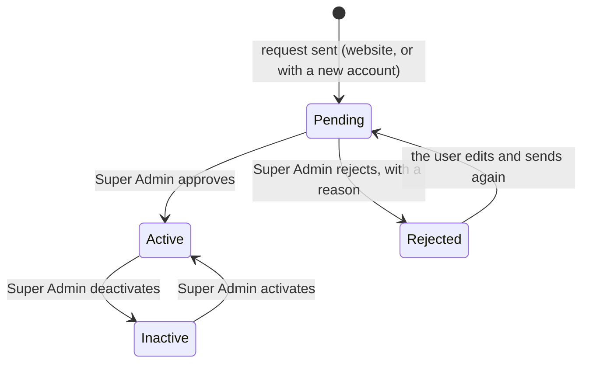

# Partner

**What it is.** Safari operators (partners) and their requests to become one: the `partner` row (one per account, request and partner in one) and the parks they operate in (`partner_park`). The API module `apps/api/src/modules/partner/`, mounted at `/api/partner`. The process is in [WITW-Packages-Workflow](../../workflows/WITW-Packages-Workflow.md) §1, §2 and §12.1–12.2.

**Who uses it.** Website users and guests send a request (Become a Partner); the Super Admin approves, rejects and manages partners in the console (Partner Requests, Partners). The screens: Become a Partner on the website (`/become-a-partner`: the form for a guest or a signed-in user, the status card once there is a request; its **Open Partner portal** button goes to `NEXT_PUBLIC_PARTNER_PORTAL_URL`) and, in the console, Partners › Partner Requests (`/partner-requests`: view, approve, reject with a reason) and Partners › Partners (`/partners`: view, edit details, logo and parks, Show phone numbers, deactivate / activate). In the Partner portal (partner app) the account sends or re-sends its request (`/partner-request`) and an Active partner sees its Business Profile (`/business-profile`), view only ([partner-portal](../../platform/partner-portal.md)).

**Workflows:** [WITW Packages](../../workflows/WITW-Packages-Workflow.md).

## Statuses

`partner.status`: 1 Pending, 2 Rejected, 3 Active, 4 Inactive (`PartnerStatus` in `types/partner.types.ts`). A partner is never deleted.

## Rules

- **One request per account** (`partner.user_id` is unique): a second one → 409 `PARTNER_REQUEST_EXISTS`.
- **Business details** (checked by the route and the service, the boards' wording): business name and owner name required, up to 255 ("Enter the business name." / "Enter the owner name." / "Use up to 255 characters."); business phone 10 digits starting 6–9 ("Enter the business phone." / "Enter a 10-digit number starting with 6, 7, 8 or 9."); business email valid, up to 254 ("Enter the business email." / "Enter a valid email address."); about optional, up to 2,000; parks `masterParkIds`, at least one ("Choose at least one park.").
- **Parks are checked in the service** (there are no foreign keys): every chosen park must exist and be active, except a park the partner already has, which may stay after it is made inactive; at least one chosen park must be active. Otherwise 422 `PARTNER_PARK_NOT_AVAILABLE` / `PARTNER_PARKS_REQUIRED` on `masterParkIds`. Removing a park sets its `partner_park` row to −1; choosing it again sets it back to 1.
- **Guest request** (`POST /requests/with-account`, public, website only): Sign Up's account fields and rules (`signUpAccountSchema` from the auth module: `name`, `email`, `mobile`, `password`, Sign Up's messages, `EMAIL_TAKEN` / `MOBILE_TAKEN`) plus the business details, in one flat body. The account, the request and the sign-in happen in **one transaction** through `authService.signUpWith`; the answer sets the website's sign-in cookies exactly as Sign Up and is 201 `{ user, request }` "Your account is created and your partner request is sent.". From another app → 422 `AUTH_APP_NOT_ALLOWED`.
- **Send again**: only a Rejected request (`PUT /requests/mine`), with the same details and parks; it goes back to Pending, the reason is cleared and `requested_at` is the new send. Otherwise 409 `PARTNER_REQUEST_NOT_REJECTED`. No notification on a request.
- **Logo**: JPG, JPEG, PNG or WEBP, up to 1 MB, checked from the file's bytes ("Choose a JPG, JPEG, PNG or WEBP file." `PARTNER_LOGO_TYPE`; "Choose a file up to 1 MB." `UPLOAD_REJECTED`), multipart field `logo`. It is sent on its own after the request (the form sends the details, then the logo), stored at `partner/<partner id>/logo/<file>` with only the file name in `partner.logo`; `logoVersion` in the answers is that name, for the picture URL's `v=`. When a logo is replaced or removed (by the applicant or the Super Admin), the old file is deleted from storage once the change is saved. The applicant changes or removes it while Pending or Rejected (else 409 `PARTNER_REQUEST_LOCKED`); the Super Admin on an Active or Inactive partner. Shown only through the API: privately to the applicant (`/requests/mine/logo`) and the Super Admin (`/admin/partners/:id/logo`); and publicly at `GET /api/partner/partners/:id/logo` (`Cache-Control: public`) for an Active or Inactive partner only, because the website shows a partner as the business name and logo (workflow §2.5, e.g. in Shared Safari discussions). A Pending or Rejected request's logo, an unknown id or a partner with no logo answers 404 `PARTNER_LOGO_NOT_FOUND`.
- **Logo field** (the same `components/partner/logo-picker.tsx` in web, manage and partner): a 64 px square showing the WITW logo (`/witw/logo.png`) while there is no logo, the saved logo, or the chosen file's preview; an **Upload logo** button opens the (hidden) file input, the chosen file's name shows beside it, and **Remove** clears the choice or removes the saved logo. The helper line and the error sit under the field.
- **A partner with no logo** shows the WITW default logo (`/witw/logo.png`, object-fit contain on the surface background; alt "No logo yet") wherever the business is shown: the website's account button and Shared Safari avatars, the console's Partners list and view logo box, the portal's header and Business Profile. It never shows initials; people who are not partners keep their initials.
- **Approve** (Pending only, else 409 `PARTNER_REQUEST_NOT_PENDING`): Active, `decided_at` / `decided_by`, `approved_at` the first time ("partner since"); the account gets the **Partner** role (`meta_role` 101, `MetaRole.PARTNER`) through `usersService.grantRole`; the parks stay the request's. "{business} is now a partner."
- **Reject** (Pending only): reason required, up to 512 ("Enter the reason." / "Use up to 512 characters."); the user sees it. "Request rejected. {owner} sees the reason."
- **Partners** (Active and Inactive): edit business details and parks in one save ("Partner details saved."), logo on its own route; Show phone numbers on / off; Deactivate (Active only) / Activate (Inactive only), else 409 `PARTNER_STATUS_UNCHANGED`. The Partner role stays on the account when a partner is deactivated; the partner's status decides.
- **Lists**: Partner Requests lists Pending and Rejected, Pending first then newest sent; Partners lists Active and Inactive by business name. Both search business and owner name and filter by status. Each item has the parks, the account (name, email, mobile) and `livePackageCount` (the partner's packages with website status Active while the partner is Active, else 0).
- **For other modules** (`partnerService` from `createPartnerModule`): `activePartnerOf(userId)` (an Active partner, or null), `partnerOf(userId)` (Active or Inactive, or null) and `partnersOf(userIds)` (the same for many accounts at once: a map from account id to partner, Active and Inactive only), each giving the partner id, account id, business name, status, logo version and `isPhoneShown` (Show phone numbers: the [quote-request](../quote-request/README.md) module shows users' phones in the partner's Quote Requests only while it is on; `partnerOf` also refuses partners sending quote requests). `parksOf(partnerId)` gives the partner's parks (id, name, park status), used by the gallery and package modules for "one of the partner's own active parks". `activePartnerById(partnerId)` gives an **Active** partner's public details (id, account id, business name, about, logo version, the ids of its parks that are active for the partner and active as parks), or null: the [profile](../profile/README.md) module's Partner Profile. The [wishlist](../wishlist/README.md) and [chat](../chat/README.md) modules use `partnerOf` to refuse partners, and chat `partnersOf` to tell which conversation partners can no longer receive. The package module's "shown on the website" rule also needs the partner to be Active, so deactivating a partner hides every package of theirs at once ([package](../package/README.md)); the Partner portal's notification feed answers only an Active partner ([notification](../notification/README.md)); the [shared-safari](../shared-safari/README.md) module uses `partnerOf` / `partnersOf` to refuse partners organising or joining and to show them as the business.
- **Audit** (module 10, entity 13): 1001 request sent · 1003 sent again · 1005 approved · 1007 rejected · 1009 edited · 1011 logo changed · 1013 deactivated · 1015 activated · 1017 phone numbers shown · 1019 hidden · 1021 / 1023 demo data added / removed · 1025 `ct_` test data removed (`test-data/remove-ct`); each failure is the next number. Granting the role is a users-module 103 event.

## Routes

| Route | Access |
|---|---|
| `POST /api/partner/requests/with-account` | public (named in the plan §2.4) |
| `GET /api/partner/requests/mine` (null when none), `POST /requests`, `PUT /requests/mine` | signed-in |
| `GET` / `PUT` / `DELETE /api/partner/requests/mine/logo` | signed-in |
| `GET /api/partner/partners/:id/logo` (Active and Inactive partners) | public (named in the plan §2.4) |
| `GET /api/partner/admin/requests`, `GET /admin/requests/:id`, `POST /admin/requests/:id/approve`, `POST /admin/requests/:id/reject` | Super Admin |
| `GET /api/partner/admin/partners`, `GET` / `PUT /admin/partners/:id`, `GET` / `PUT` / `DELETE /admin/partners/:id/logo`, `PATCH /admin/partners/:id/phone-numbers` `{ isPhoneShown }`, `PATCH /admin/partners/:id/status` `{ status: 3 | 4 }` | Super Admin |

The parks to choose from come from `GET /api/park/active` (public).

## Demo data (local only)

`npm run cli packages-demo/add <password> confirm` adds the prototype's sample partners: Jungle Trails Safaris (Vivek Rao, Active) on the local account `partner@example.in` (the prototype's signed-in partner), with a "JT" logo (`apps/api/seed/packages-demo/jungle-trails-logo.png`, set through `partnerDemoService.setLogo` only when it has none, audited as a logo change; the board has no logo, kept from the local-accounts requirement), and on their own `@packages-demo.test` accounts Tiger Trail Tours (Tara Nambiar, Active), Wild Routes India (Dev Khanna, Pending), Green Canopy Tours (Isha Kapoor, Rejected), Bush Camp Expeditions (Nikhil Bose, Inactive); the website users who send the demo quote requests are Ananya Iyer (`user@example.in`), Riya Sharma and Neha Singh (the Shared Safari sample accounts). Accounts are created when missing with the password given. A partner is found by its account; the command refuses to write when a plan account already has a partner of another business name. Dry run without `confirm`; safe to run again; refused in production. `npm run cli packages-demo/remove confirm` removes the demo partner rows (taking the Partner role back from an account that stays, such as `partner@example.in`), their parks and folders `partner/<id>/` in storage, and only the `@packages-demo.test` accounts (dry run without `confirm`). The command's data is in `src/cli/controllers/packages-demo/`; it also adds the demo galleries, packages and quote requests (the galleries: [gallery](../gallery/README.md); the packages: [package](../package/README.md); the quote requests: [quote-request](../quote-request/README.md)).

`npm run cli local-accounts/add <password> confirm` adds only the three local test accounts (Super Admin, `partner@example.in`, `user@example.in`): [local development › Local test accounts](../../platform/local-development.md#local-test-accounts).

## History

- Planning files: [2026-11-12-safari-packages](../../../planning/features/2026-11-12-safari-packages.md), [2026-11-16-local-accounts-and-logo-field](../../../planning/features/2026-11-16-local-accounts-and-logo-field.md), [2026-11-16-full-test-and-docs](../../../planning/features/2026-11-16-full-test-and-docs.md)
