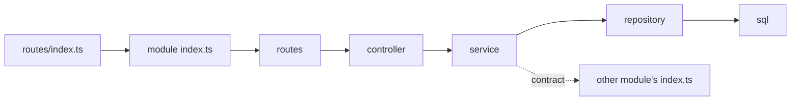

# Adding a module

**What it is.** How to add a new business area (e.g. orders, customers, invoices) to the API. Every business area is one **module**: a folder that holds all of its own code, which other code can reach only through the module's front door, `index.ts`.

**Who uses it.** Developers and agents working in `apps/api`.

## The flow

1. **Plan it.** Create `docs/planning/features/<date>-<slug>.md` from the template and agree the requirement.
2. **Tables, if any.** Write a dated migration in `apps/api/src/database/migrations/` and let the user run it. Nothing applies schema changes automatically.
3. **Create the folder** `apps/api/src/modules/<module>/`, with only the sub-folders it needs. Copy from `modules/health/`, the smallest working example.
4. **Build it bottom-up:**
   - `sql/`: the named SQL statements.
   - `repositories/`: run those statements. Every method takes the database executor (`db`) as its first argument.
   - `services/`: the business rules. The service calls the repositories and, if needed, other modules' services.
   - `validators/`: zod schemas for request input.
   - `controllers/`: read the request, call the service, send the response with a `core/http` helper (`ok`, `created`, `noContent`, `paginated`, `sendDownload`). Nothing else.
   - `routes/`: connect URLs to controller methods with `apiRouter()`: path, **access**, then `validate(schema)` and `asyncHandler()` ([route access](route-access.md)).
5. **Wire the front door.** In `index.ts`, `createXModule(deps)` builds repository → service → controller → router and exports only what others may use (the router and the service contract, never the repositories).
6. **Mount it** in `apps/api/src/routes/index.ts`: `...mountApi(app, '/api/<module>', x.createRouter(superAdmin))`, passing the access its routes need. If it needs another module's service, pass it in there. Check `npm run cli route/list`.
7. **Check it.** `npm run verify` (type-check + lint, which also checks the module boundaries) and `npm run build`, then call the endpoints.
8. **Document it.** Write or update its docs in `docs/how-it-works/modules/<module>/`.

## Rules

- Outside a module, import only its `index.ts`.
- Only a service may use another module, and only through that module's service contract.
- **Writes are owned, reads are open.** A module INSERTs / UPDATEs / DELETEs only its own tables. Its SELECTs may JOIN any table, including other modules' tables and the global masters, for lists, detail pages and reports. A read with business meaning ("is this user active and allowed to sign in?") still goes through the owning module's service, so the rule lives in one place.
- Controllers never touch repositories, SQL or the database.
- **Every route states its access** through `apiRouter()`; nothing is public unless it says `publicAccess` ([route access](route-access.md)).
- **Every response goes through `core/http`.** Success: `ok()`, `created()`, `noContent()`, `paginated()`, or `sendDownload()` for a file; every one sends the same envelope `{ success, message, data, meta? }`, which each app's `api-client.ts` reads. Errors are thrown and the error handler sends `{ success: false, message, code, requestId, errors? }`. Nothing outside `core/` calls `res.json`, `res.send`, `res.status`, `res.sendFile`, `res.redirect` or pipes into `res`; cookies and headers are allowed. A response the helpers don't cover (a CSV export, a redirect) gets a new helper in `core/http`, used everywhere after.
- A module never reads `.env`/`config/` and never opens its own database connection; everything is passed in.
- Outside services (email, payment, SMS …) are used through `apps/api/src/infrastructure/` contracts, never a vendor SDK directly.

`npm run lint` fails if any of these are broken.

## Where it lives

- **Modules:** `apps/api/src/modules/` (anatomy in its README)
- **Mount point:** `apps/api/src/routes/index.ts`
- **Example:** `apps/api/src/modules/health/`
- **Boundary and response rules:** `apps/api/eslint.config.mjs`
- **Response helpers:** `apps/api/src/core/http/`

## History

- Planning files: [2026-10-28-starter-core](../../planning/features/2026-10-28-starter-core.md), [2026-10-28-api-response-lint](../../planning/features/2026-10-28-api-response-lint.md), [2026-10-28-route-access](../../planning/features/2026-10-28-route-access.md)
