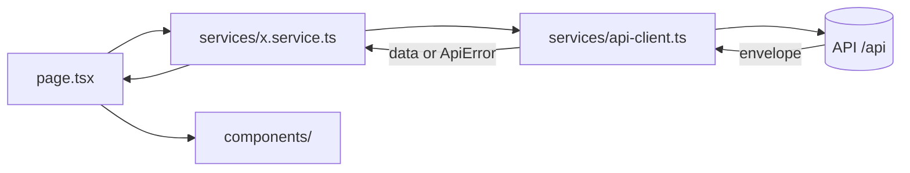

# Frontend apps

**What it is.** The web apps people use: `manage` (the Super Admin console, port 3041 locally) and `web` (the example portal, port 3040). Each is a separate Next.js app with **the same folder structure and rules**. They share no code: not with each other, not with the API. Everything they know comes from the API over HTTP.

**Who uses it.** Developers working in `apps/manage`, `apps/web` and every app a project adds (a new app starts as a copy of `web`).

## The flow: how a screen gets its data

1. A **page** in `src/app/` (a route) calls a function in `src/services/<feature>.service.ts`, e.g. `listUsers()`.
2. The **service** knows the URL and method and calls `apiClient.get('/users')`.
3. The **api-client** (`src/services/api-client.ts`, the only `fetch` to the API) adds the base URL from config, sends JSON with the header `X-Client-App: <app>` (so the API knows which app the call came from, e.g. for the [audit log](../modules/audit/README.md)) and `x-language`, and unwraps the API's envelope:
   - success → returns `data` (or `{ items, meta }` for paginated lists),
   - failure → throws an `ApiError` with the API's `code`, `message`, `requestId` and field `errors`.
4. The page hands the data to **components** in `src/components/`. On an `ApiError`, the screen decides what to show by `code` (e.g. `USER_NOT_FOUND`), never by message text. A form shows `error.fieldError('email')` under its field.
5. If a page throws, it shows the **500** card; an address that does not exist the **404**; a page the person may not open the **403**; while a page loads, the **loading** card. They are shown inside the frame of where they happen (header and menu stay).



## Folder structure (same in every app)

```
src/
├── app/          Routes only: page.tsx, layout.tsx, error.tsx, not-found.tsx, route groups
├── components/
│   ├── ui/       Reusable, feature-free pieces (pager, toast, searchable select, export button …)
│   ├── layout/   Error and loading cards, the frame boundary
│   ├── console/  The signed-in frame: header, sidebar, menu data, user menu, change password
│   └── <feature>/  UI for one feature, named like the API module
├── hooks/        <feature>/ hooks (client-side state and behaviour)
├── services/     api-client.ts, api-error.ts, <feature>.service.ts (one per API module)
├── types/        api.types.ts (the envelopes), <feature>.types.ts (mirrors of API response shapes)
├── lib/          config.ts (validated public env), server-config.ts (server-only env), logger/, i18n/, helpers
├── instrumentation.ts         server-side logging hooks
└── instrumentation-client.ts  browser-side logging, started before hydration
```

Also `src/app/client-logs/route.ts`: receives this app's browser logs ([frontend-logging.md](frontend-logging.md)).

## Route groups

Named by who may open them, not by what the pages are:

| App | Group | Who |
|---|---|---|
| both | `(public)` | anyone: login, forgot / reset password; in web also the welcome page at `/` (what the template is, how to install it, how to make it a new project) |
| manage | `(dashboard)` | a signed-in Super Admin, from `/` ([manage-console.md](manage-console.md)) |
| web | `(portal)` | any signed-in user, from `/dashboard` (sign-in lands there) |

## Rules

- **Only `src/services/` calls the API**, and only through `api-client.ts` (lint-enforced).
- **`process.env` is read only in `src/lib/config.ts`** (public values) and `src/lib/server-config.ts` (server-only values), validated with zod (lint-enforced). `NEXT_PUBLIC_*` values end up in the browser: never put a secret in them, and rebuild after changing one.
- **Pages stay thin:** get data from a service, pass it to components. No `fetch`, no business rules.
- **API data is live by default** (`cache: 'no-store'`).
- **Each app has its own theme and favicon:** both use the WITW Design System of the prototype (primary green #09422D, WITW yellow and orange accents, Roboto). manage takes its Console values (`[data-portal="admin"]` and `:root` in its `globals.css`: status text darkened to meet WCAG AA, a red delete button); web takes the Portal values, WITW website colours exactly (`[data-portal="web"]`: orange hover, a yellow delete button, display headings in Devator Exp falling back to Roboto). Roboto is loaded with `next/font/google` in `src/lib/fonts.ts` (self-hosted at build, the `--font-roboto` variable feeds `--font-sans`). The favicon is `public/favicon.ico`, a white shield on a rounded square in the app's colour.
- **Two frames:** the console has a sidebar (`app sl`, the admin frame). web is a portal: its public pages (welcome, sign-in, forgot password) use the website frame (`components/website/website-shell.tsx`: top bar with Home, Install, New project, Sign in; footer), and its signed-in pages a header with a horizontal menu bar (`app top`, `components/console/portal-nav.tsx`), no sidebar.
- **Design tokens live in `src/app/globals.css`.** Never raw hex values in components. Tailwind v4 silently ignores a class whose token is missing, so add the token first.
- **Types mirror the API.** When an API response shape changes, the matching `types/` file in every app that uses it changes in the same commit.
- **No shared code between apps.** A component needed in two apps is copied, and the copies are kept identical (same path and name).
- **One session for every app:** the API sets one cookie pair (`access_token`, `refresh_token`) on the parent domain (`AUTH_COOKIE_DOMAIN`), so signing in on one app signs in on all. Each app's server reads `ACCESS_TOKEN_COOKIE` (`lib/config.ts`, with `NEXT_PUBLIC_AUTH_COOKIE_PREFIX` in front, the same as the API's `AUTH_COOKIE_PREFIX`).
- **A tab whose session changed goes to `/login`:** the signed-in frame calls `useSessionWatch(user.id)`, and the api-client sends `X-Session-User` on every browser call; the API answers `SESSION_CHANGED` when another tab signed in as someone else.
- **Toasts close by themselves** after 5 seconds.
- **Save takes the person to the first error** (`hooks/ui/use-reveal-first-error.ts`), and errors are shown under their field.
- **Number fields** are `type="text"` with `inputMode`, cleaned as typed (`lib/number-input.ts`, `lib/mobile-input.ts`), with no `maxLength`.
- **Searchable dropdowns** (`SearchableSelect`, `RemoteSelect`) for any field choosing from a data list; the open list floats above the page.
- **One pager on every list:** `components/ui/page-buttons.tsx`.
- **Translations:** a page asks for its text in English, `t('Save')` from `serverTranslator()` in server components, `useT()` in client components ([modules/language](../modules/language/README.md)).
- **Hiding a link is not access control.** Restricted areas are guarded by the route group's layout and, for real, by the API.
- **Read the Next.js 16 docs** in `node_modules/next/dist/docs/` before using a Next.js API.

## Backdrop blur: write the `-webkit-` spelling first

A blur behind a popup or menu is written `-webkit-backdrop-filter:…;backdrop-filter:…` (the `-webkit-` spelling **first**): the build's CSS optimiser keeps only the last of the two, and Chrome ignores the `-webkit-` one.

## Where it lives

- **Apps:** `apps/manage/`, `apps/web/` (each with a README)
- **API client:** `src/services/api-client.ts`, `src/services/api-error.ts`, `src/services/session-user.ts`, `src/hooks/session/use-session-watch.ts` in each app
- **Config:** `src/lib/config.ts` and `.env.example` in each app
- **Lint rules:** `eslint.config.mjs` in each app

## History

- Planning files: [2026-10-28-starter-core](../../planning/features/2026-10-28-starter-core.md), [2026-11-02-witw-theme](../../planning/features/2026-11-02-witw-theme.md)
