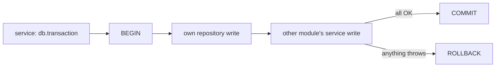

# SQL transactions

**What it is.** A SQL transaction makes several database writes **all succeed or all fail**. If one write fails, every write before it in the same transaction is undone (rolled back), so the database never ends up half-updated. Example: "create a booking" and "debit the wallet" must happen together or not at all.

**Who uses it.** Developers writing services in `apps/api`.

## The flow

1. A service that starts an operation wraps the writes in `this.db.transaction(async () => { … })`.
2. The API opens one database connection and runs `BEGIN`.
3. Every query made while the callback runs uses that connection. This includes queries made by **other modules' services** it calls. Nobody passes a `tx` parameter; they join automatically.
4. The callback finishes → `COMMIT`: all writes are saved.
5. Anything throws → `ROLLBACK`: all writes are undone, and the error continues to the caller (and then to the error handler, which answers the request).

```ts
// bookings.service.ts
await this.db.transaction(async () => {
    await this.bookingRepository.create(this.db, input);   // joins the transaction
    await this.walletService.debit(userId, amount);        // another module: joins too
});
```

`walletService.debit()` needs no changes. Called on its own it runs normally; called inside a transaction it becomes part of it.



## Rules

- **The service that starts the whole operation opens the transaction.** Called services don't open their own for the same work. If they do, nothing breaks: a `transaction()` inside another one simply joins it (still one `BEGIN`, one `COMMIT`).
- **Keep it short.** Only database work inside. No emails, payment-gateway calls, file uploads or other slow network calls: they hold the connection and row locks while they wait, and they can't be rolled back anyway. Do them after the transaction commits.
- **Await everything inside.** Don't start database work inside a transaction without awaiting it: it would run on the transaction's connection after the transaction has finished.
- **Parallel queries are allowed** (`Promise.all`) and stay on the transaction's connection, but they run one after another on that one connection.
- **Separate requests never share a transaction.** Each request's `transaction()` gets its own connection.
- **No retries inside a transaction.** Outside one, a query that fails because the connection was lost is retried; inside one it fails, so a half-done transaction is never quietly continued.
- `db.isInTransaction()` tells you whether the current code is running inside one (useful for a guard or a log line).

## Where it lives

- **Code:** `apps/api/src/database/connection/create-connection-pool.ts` (`transaction()`, using Node's `AsyncLocalStorage`) and `apps/api/src/database/transactions/with-transaction.ts` (the only place `BEGIN` / `COMMIT` / `ROLLBACK` are sent)
- **Type:** `Database.transaction` in `apps/api/src/database/connection/types.ts`

## History

- Planning files: [2026-10-28-starter-core](../../planning/features/2026-10-28-starter-core.md)
