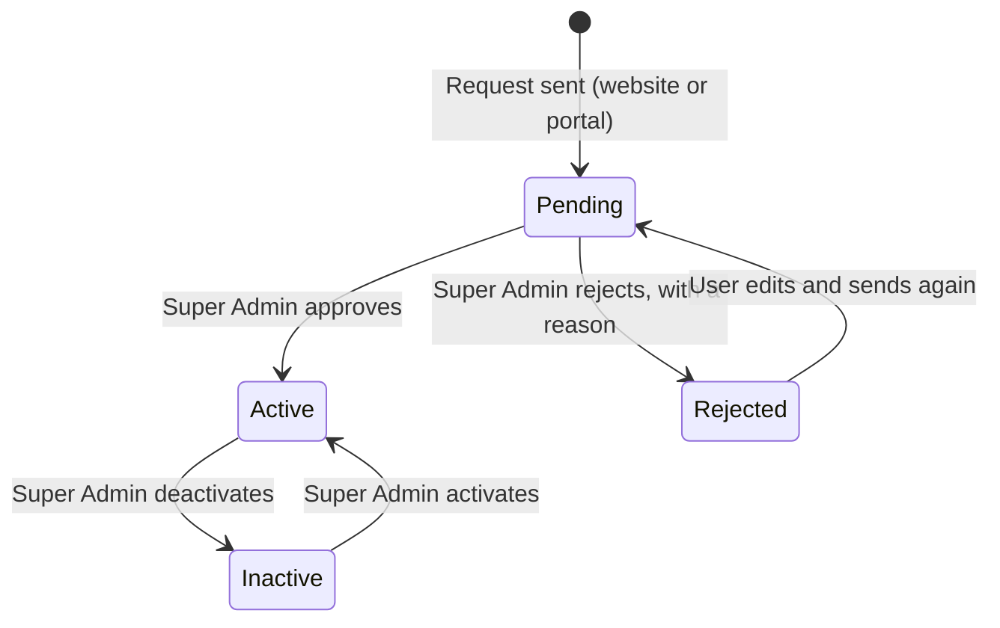
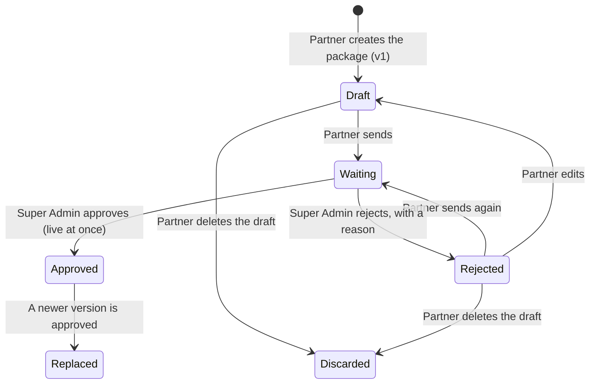
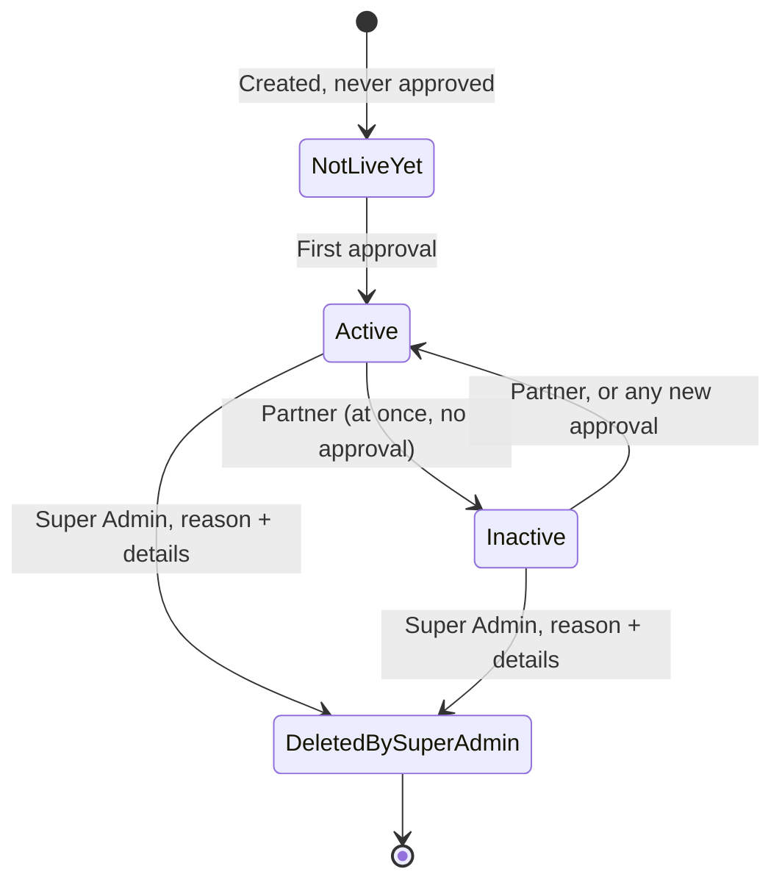
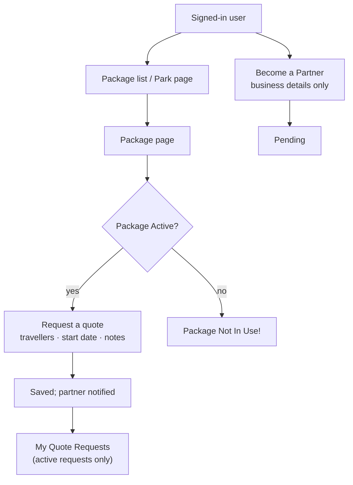
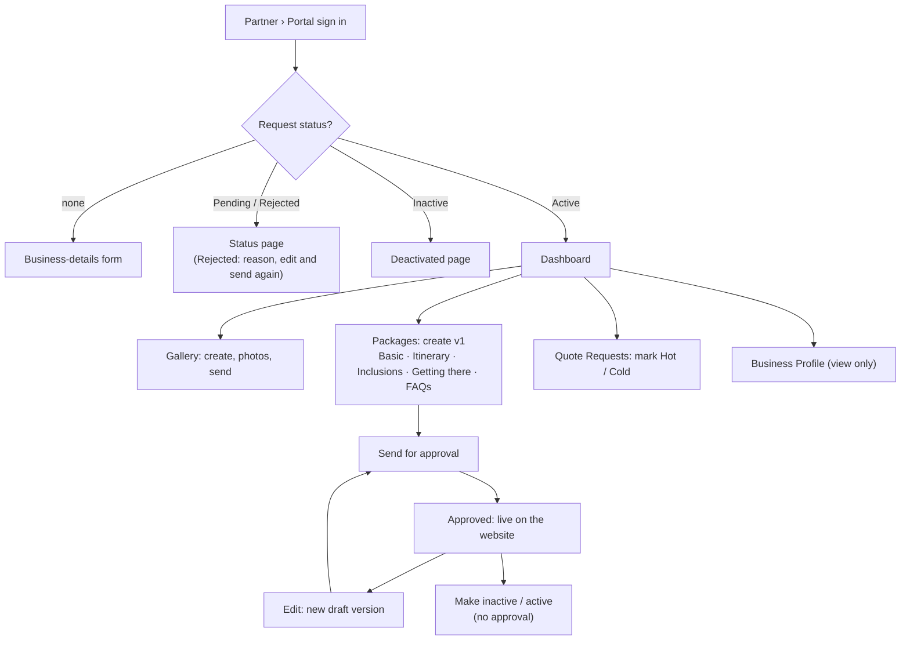
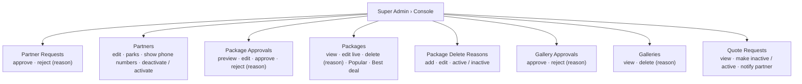
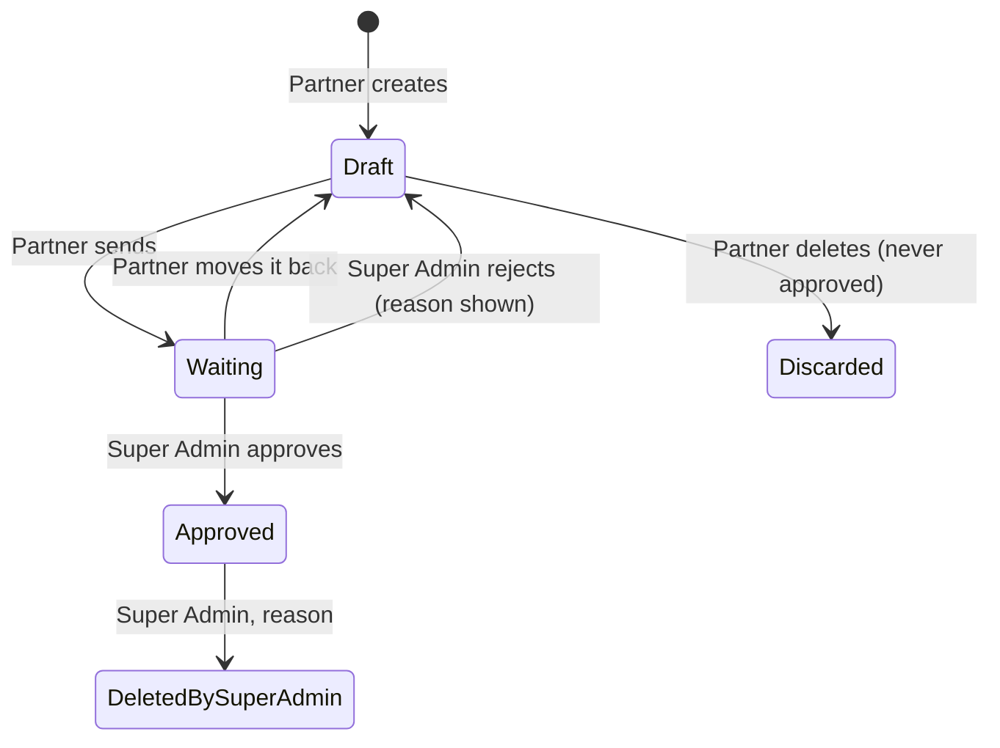

# Packages: the process

Safari operators (**partners**) sell ready-made safari packages: a trip to one or more parks with its days, stay, inclusions and price. A person applies to become a partner, the Super Admin approves them, and they build packages and photo galleries in a new **Partner portal**. The Super Admin approves every package version and every gallery before it is used. On the website, users browse packages and parks and send a **quote request** to a package's partner. Nothing is paid in the app.

**Status: in sync with the requirements** (`WITW-Packages-Requirements.docx`), in the same shape as the Shared Safari workflow. The requirements are the source: every rule here comes from them. Anything marked *(proposed)* (messages, screen names, rules) is not in the requirements yet; it is listed in §16 and goes into the requirements once signed off.

**Apps:** Website · **Partner portal** (new) · Console.
**Roles:** Guest, User, Applicant, Partner, Super Admin.

## What this feature adds

| Area | Today (live site) | With Packages |
|---|---|---|
| Who makes packages | — | **Partners** (safari operators), each approved by the Super Admin |
| Partner portal | None | **New app**: Dashboard, Packages, Gallery, Quote Requests, Notifications, Business Profile |
| Becoming a partner | None | **Become a Partner** page on the website; request approved or rejected in the console |
| Package editing | — | **Versions** (v1, v2 …): every change is approved again; the live version stays until then |
| Galleries | — | Named photo sets per park, **approved** before use, attached to packages and itinerary days |
| Package card | Image, park, days / nights, safaris, prices, "Include taxes and fees", **View Details** | Adds **tag**, activity line, struck-out price, price message, **Best deal** badge |
| Package list | "Safari Packages" (`/package`) | Search, filters (park, price, nights, safaris, stay, features, inclusions), chips, 5 sorts, 12 per page |
| Package page | — | Top details, price box with **Request a quote**, 5 tabs, gallery slider, disclaimer |
| Quote requests | None | Users send one to the partner; partner marks **Hot / Cold**; Super Admin oversees all |
| Parks on the website | Park cards linking to `/park/<slug>` | Park list (search, region, A–Z / Z–A) and park page tabs **Overview (with a Leaflet map) · Packages · Shared Safaris** |
| Partner on the website | — | Shown as their **business** (name and logo), including in Shared Safari comments |
| Console | — | Partner Requests, Partners, Package Approvals, Packages, Package Delete Reasons, Gallery Approvals, Galleries, Quote Requests |

## The whole flow at a glance

```
     Website                         Partner portal                          Console (Super Admin)
     ───────                         ──────────────                          ─────────────────────
 USER: Become a Partner ─────────────────────────────────────────────▶  Partner Requests
 (account + business details)                                           approve / reject (reason)
                                                                                 │ approve
                                                                                 ▼
                                  PARTNER signs in ◀──── Partner role + parks ───┘
                                        │
                     ┌──────────────────┴──────────────────┐
                     ▼                                     ▼
              Gallery (draft) ── send ──────────────▶ Gallery Approvals
                     ◀──────────── approved / rejected (reason) ─┘
                     │ approved gallery
                     ▼
              Package v1 (5 sections) ── send ──────▶ Package Approvals
                     ◀───── approved (live) / rejected (reason) ─┘
                     │ Active + partner Active
                     ▼
 PACKAGE LIST / PARK PAGE ◀── GUEST and USER browse, filter, sort
          │
          ▼
    PACKAGE PAGE ── USER: Request a quote ──▶ Quote Requests ──────────▶  Quote Requests
                     (partner notified)       (Hot / Cold)               (make inactive / active,
                                                                          notify partner)
                                                                         Packages: edit, delete
                                                                         (reason), Popular, Best deal
```

## The life of a partner



A partner is **never deleted**. A user has **one** partner request.

## The life of a package version



- Editing an **Approved** (live) version makes a **new Draft**, a copy of the live one; the live version stays on the website until the new one is approved.
- A package has at most **one live version** and **one version being worked on**.

## The website status of a package



**Shown on the website** only when all three hold: the package has a **live version**, it is **Active**, and its partner is **Active**. No date removes a package.

**Dates and prices:** dates are shown in **Indian time (IST)**; prices are **whole rupees** with Indian grouping (₹1,25,000). **Nothing is ever erased:** deleted items are kept and marked.

## The flow per role

### A. Guest (not signed in)

- **Browsing:** the package list, the park list, package pages and park pages, with all filters and sorts.
- **Request a quote:** takes the guest to Login *(proposed)*.
- **Become a Partner:** fills the account details and the business details; sending creates the account, signs them in and sends the request.

### B. User (signed in, not a partner)



### C. Partner (Partner portal)



### D. Super Admin (console)



---

## 1. Who can do what

| Action | Guest | User | Applicant (Pending / Rejected) | Partner (own items) | Super Admin |
|---|---|---|---|---|---|
| Browse packages and parks, filter, sort | ✓ | ✓ | ✓ | ✓ | |
| Become a Partner (send a request) | ✓ (with account details) | ✓ | Edit and send again (Rejected) | | ✓ (can apply too) |
| Request a quote, My Quote Requests | | ✓ | ✓ | ✗ (note with Partner portal link) | |
| Organise or join a new shared safari | | ✓ | ✓ | ✗ | |
| Comment on shared safaris joined / hosted before | | ✓ | ✓ | ✓ (shown as the business) | |
| Create and edit packages and galleries, send for approval | | | | ✓ | |
| Make a package inactive / active | | | | ✓ | |
| Mark quote requests Hot / Cold | | | | ✓ | |
| See Business Profile | | | | ✓ (view only) | ✓ (edit, in Partners) |
| Approve / reject partners, packages, galleries | | | | | ✓ |
| Edit a waiting or live package, delete a package or gallery | | | | | ✓ |
| Popular, Best deal, Show phone numbers | | | | | ✓ |
| Manage Package Delete Reasons, quote requests | | | | | ✓ |

- **One account per person.** **Partner** is a role added to that account when the Super Admin approves the request; until then they are a normal user.
- Partners sign in to the portal with the **same details** as the website.
- A partner sees and changes **only their own** packages, galleries and quote requests.

## 2. Accounts and becoming a partner

### 2.1 Where the request is sent

| Where | Who | What they fill | Result |
|---|---|---|---|
| Website › **Become a Partner** | Guest | Account details (§2.2) + business details (§2.3) | Account created, signed in, request sent (Pending) |
| Website › **Become a Partner** | Signed-in user | Business details only | Request sent (Pending) |
| Partner portal | User with no request | Business details only | Request sent (Pending) |

- **Portal sign-in:** anyone with an account can sign in. The portal has **no sign-up**; its sign-in page links to **Become a Partner**. Forgot password works as on the website.
- **What the portal shows after sign-in:**

| Request | Portal shows |
|---|---|
| None | Only the business-details form |
| Pending | Status page *(proposed: "Your request is under review.")* |
| Rejected | Status page with the **reason**, and **Edit and send again** |
| Inactive partner | Only: "Your account has been deactivated. Please contact the administrator for further assistance." |
| Active partner | The full portal (§3) |

- **No OTP or email check:** the Super Admin's approval is the check.

### 2.2 Account details (guests only)

The website's Sign Up fields and rules.

| Field | Required | Rules |
|---|---|---|
| Name | Yes | Up to 100 characters |
| Email | Yes | Valid; not used by another account. "An account with this email already exists." |
| Mobile | Yes | 10 digits, starting 6–9; not used by another account. "An account with this mobile number already exists." |
| Password | Yes | 8 to 72 characters |

### 2.3 Business details

| Field | Required | Rules · messages *(proposed)* |
|---|---|---|
| Business name | Yes | Up to 255 characters. "Enter the business name." · "Use up to 255 characters." |
| Owner name | Yes | Up to 255 characters. "Enter the owner name." |
| Business phone | Yes | 10 digits, starting 6–9. "Enter a 10-digit mobile number." |
| Business email | Yes | Valid email. "Enter a valid email address." |
| Parks you operate in | Yes | One or more **active** parks. "Select at least one park." |
| About your business | No | Text |
| Logo | No | JPG, JPEG, PNG or WEBP, up to **1 MB**. "Use a JPG, JPEG, PNG or WEBP image." · "Use an image up to 1 MB." |

### 2.4 Partner request statuses

| Status | Set by | Effect |
|---|---|---|
| **Pending** | Sending the form; sending again after a rejection | Waits in Console › Partner Requests. No notification |
| **Rejected** | Super Admin, with a reason | The user sees the reason, can edit and send again |
| **Active** | Super Admin approves; activates | Account gets the **Partner** role with the **parks from the request**; full portal |
| **Inactive** | Super Admin deactivates | All the partner's packages hidden from the website; portal shows only the deactivated message |

### 2.5 A partner on the website

A partner works on packages **only in the Partner portal**. On the website, from approval onwards (**also while Inactive**):

| Area | Rule |
|---|---|
| Name and picture | Shown as the **business name** and the partner **logo** (a standard placeholder with no logo): header, account menu, and every comment and reply, including Shared Safari discussions. The comment is still the person's own |
| Quote requests | **Can't send one**; no My Quote Requests. In place of the quote form: a note with a **Partner portal** link |
| Shared safaris | **Can't organise or join a new one.** Safaris hosted or joined before becoming a partner stay as they are, and they can still comment on them |
| Account menu | Has a **Partner portal** link |

> **Shared Safari impact:** the Organise button, the Join button and the comment name / initials change for partners. These are listed in the Shared Safari workflow's changes too.

## 3. Partner portal

| Menu | Shows |
|---|---|
| **Dashboard** | The number of **active** quote requests, and the **latest two active packages** |
| **Packages** | The partner's packages with versions, statuses and allowed actions (§4–§6) |
| **Gallery** | Tabs: Approved · In Draft · Waiting for Approval (§7) |
| **Quote Requests** | The partner's active requests (§9.2) |
| **Notifications** | The bell and the Notifications page, as in the other apps |
| **Business Profile** | Business details, logo and parks, **view only**. Only the Super Admin changes them |

## 4. Building a package

Partner portal › Packages › **Create package**. Five sections, **each saved on its own**; sections 2–5 open once **Basic** is saved. Creating the package makes **v1** as a Draft.

### 4.1 Section 1: Basic

| Field | Required | Rules · messages *(proposed)* |
|---|---|---|
| Package name | Yes | Up to **215** characters. "Enter the package name." · "Use up to 215 characters." |
| Parks | Yes | One or more of the **partner's own active parks**. The first is the **main park** *(proposed)*. "Select at least one park." |
| Days | Yes | 1 to 15; **nights = days − 1**, set automatically. "Enter a number from 1 to 15." |
| Safari type | Yes | Shared · Private (§13). "Select a safari type." |
| Vehicle | Yes | From the list (§13). "Select a vehicle." |
| Theme | Yes | Packages' own list (§13). "Select a theme." |
| Stay | Yes | From the list (§13). "Select a stay." |
| Number of safaris | Yes | 1 to 99. "Enter a number from 1 to 99." |
| Features | No | Any of the list (§13) |
| Start place · End place | No | Letters, spaces and hyphens; up to 215 characters. "Use letters, spaces and hyphens only." |
| Price per person (₹) | Yes | 1,000 to 99,99,999. "Enter whole rupees from ₹1,000 to ₹99,99,999." |
| Total price (₹) | Yes | 1,000 to 99,99,999. At least the price per person *(proposed, §16 #6)*: "The total price can't be less than the price per person." |
| Price before discount (₹) | No | 1,000 to 99,99,999; shown struck out on the card. Higher than the price per person *(proposed, §16 #6)*: "The price before discount must be higher than the price per person." |
| Activity message | No | Up to 255 characters; replaces the standard line, e.g. "3 Shared Safaris" |
| Price message | No | Up to 255 characters; when empty, "Include taxes and fees" |
| Tag | No | Text up to 255 characters, a **background colour** and a **text colour** (white by default) |
| Package image · Banner image | No | JPG, JPEG or PNG, up to **250 KB**. With no package image, the **main park's image** is used. "Use a JPG, JPEG or PNG image." · "Use an image up to 250 KB." |
| Gallery | No | One of the partner's **approved** galleries (§7) |
| Overview | No | Up to 2,000 characters |

- **Package link:** made from the name when the package is created; it **never changes**, even if the name does.

### 4.2 Section 2: Itinerary

One block per day (the number of days from Basic).

| Field | Required | Rules |
|---|---|---|
| Day title | Yes | Up to 255 characters. "Enter the day title." |
| Description | Yes | Up to 2,000 characters. "Enter the description." |
| Start location · End location · Hotel name | No | Up to 255 characters each |
| Meals | No | Breakfast · Lunch · Dinner (checkboxes) |
| Activity · Accommodation · Note | No | Up to 500 characters each |
| Day image | No | JPG, JPEG or PNG, **any size** |
| Day gallery | No | One of the partner's approved galleries |

### 4.3 Section 3: Inclusions

| Element | Rule |
|---|---|
| Each inclusion (§13) | **Included** or **Not included** |
| Meals → Included | Ticks Breakfast, Lunch and Dinner on **every day**; the partner can still change each day's meals afterwards |
| Meals → Not included | Leaves the days' meals as they are |
| More inclusions · Exclusions | Up to 512 characters each |

### 4.4 Section 4: Getting there

Text, up to 2,000 characters.

### 4.5 Section 5: FAQs

| Field | Required | Rules |
|---|---|---|
| Question | Yes | Up to 512 characters |
| Answer | Yes | Any length |

The partner can **add, edit and delete** FAQs; there is no limit on the number.

## 5. Versions and approval

**Every change needs the Super Admin's approval again.** A package is kept as numbered **versions** (v1, v2, v3 …).

| Version status | Meaning | Partner can |
|---|---|---|
| **Draft** | Being worked on | Edit, Send, Delete |
| **Waiting for approval** | Sent; read-only for the partner | View |
| **Rejected** | Sent back with a reason (shown on the package) | Edit, Send again, Delete |
| **Approved (live)** | On the website | Edit (makes a new Draft) |
| **Replaced** | An older live version, after a newer one was approved | View *(proposed)* |

- **v1** is made when the package is created.
- **Any change** to an approved package (a price, a day, a photo, an FAQ, anything in the five sections) is made in a **new version**, a copy of the live one.
- At most **one live version** and **one working version** at a time. The partner and the Super Admin always see which is which. Every version is kept, with its number, status and dates.
- **Send** is possible from Draft or Rejected.
- **Super Admin:** can **edit** the waiting version, then **approves** or **rejects** it **as a whole** (reason required; the partner sees it on the package). Which fields the Super Admin can edit: §16 #17.
- **Approve:** the version goes live **at once**; the older live version becomes **Replaced**. Until then the website shows the live version unchanged.
- **Delete:** throws the working version away; a package **never live** is deleted with it.

## 6. Website status and partner actions

### 6.1 Website status

| Status | Set by | Website |
|---|---|---|
| **Not live yet** | — (never approved) | Not shown; its link goes to the **home page** |
| **Active** | Every approval (first or an edit); the partner | Shown (if the partner is Active) |
| **Inactive** | The partner, **at once, without approval** | Hidden; page shows "Package Not In Use!" |
| **Deleted by Super Admin** | Super Admin, with a reason from the list and details; **final** | Hidden; page shows "Package Not In Use!" |

- **Every approval clears the Popular mark**; the Super Admin marks it again if wanted.
- The Super Admin can also **edit the live package directly**, with no approval step.
- The partner is **not notified** of approvals, rejections, Super Admin edits or deletes: they see the result and any reason on the package.

### 6.2 Partner actions

| Website status ↓ / Working version → | Draft or Rejected | Waiting | None |
|---|---|---|---|
| **Not live yet** | Edit · Send · Delete | View | — |
| **Active / Inactive** | Edit · Send · Delete draft · Make inactive / active | View · Make inactive / active | Edit · Make inactive / active |
| **Deleted by Super Admin** | — | — | View |

## 7. Gallery (Partner portal)

A gallery is a **named set of photos for one park**, attached to packages once approved.

| Element | Rule |
|---|---|
| Title | Required, up to 255 characters |
| Park | Required, one of the partner's own **active** parks |
| Photos | JPG, JPEG or PNG, up to **8 MB** each; no limit on the number. "Use an image up to 8 MB." *(proposed)* |
| Photo title · caption | Optional; title up to 255 characters |
| Photo actions | Replace · Remove · Reorder |
| Thumbnail | The **first photo** by default; another can be set. The thumbnail **can't be removed** |
| Menu tabs | Approved · In Draft · Waiting for Approval |

### 7.1 Gallery statuses



- **Editing an approved gallery** starts a **separate draft**; the gallery stays **Approved** and its approved photos stay in use until the draft is approved (then the draft's photos replace them).
- **Delete on that draft** discards the changes and restores the approved photos **exactly**. A gallery never approved is deleted outright.
- **Super Admin delete:** reason required, up to 512 characters; the gallery leaves the partner's Gallery menu.

### 7.2 Galleries in packages

- A package and each itinerary day attach **one whole approved gallery**, of **any park**.
- The package keeps a **copy** of the gallery as it was **when saved**. Later changes or deletion of the gallery reach the package only when the package is **saved and approved again**.

## 8. Packages on the website

### 8.1 Package list

| Part | Content |
|---|---|
| Card | Package image · tag · name · main park · days / nights · activity line · price per person with the **struck-out** price · price message · total price · **Best deal** badge |
| Paging | **12 per page**, more loading on scroll |
| Filters | Search by name · Park · Price per person (slider; **₹50,000+** means no upper limit) · Nights (**10+**) · Number of safaris (**10+**) · Stay · Features · Inclusions (one or more; **any match**) |
| Chips | Each chosen filter shows as a removable chip |
| Sort | **Popular** (default: popular first, then newest) · Newest · Fewest safaris · Most safaris · Price low to high |
| Empty state *(proposed)* | "No packages match your filters." with Clear filters |

Shown only when the package has a **live version**, is **Active**, and its partner is **Active**.

### 8.2 Package page

| Section | Content |
|---|---|
| Top | Banner (or package image) · tag · name · parks · days / nights · activity line · vehicle · stay · theme · start and end place · whether **Meals** and **Pick & Drop** are included |
| Price box | Prices · price message · **Request a quote** |
| Tabs | **Overview** (with the gallery) · **Itinerary** (each day with its gallery) · **Inclusions** · **Getting there** · **FAQs** |
| Gallery slider | Gallery title (or "Gallery") · arrows · moves every **3 seconds** and **loops** · each photo's title and caption over it |
| Disclaimer (under the tabs) | "This tour is operated by our authorised safari tour operator, not directly by Walk Into The Wild. This tour is governed by the terms and conditions set forth by Walk Into The Wild." |

- **Not Active** (Inactive, Deleted by Super Admin, or partner Inactive): opens with "**Package Not In Use!**".
- **Never approved:** the link goes to the **home page**.

## 9. Quote requests

### 9.1 Sending (website)

| Field | Required | Rules · messages *(proposed)* |
|---|---|---|
| Number of travellers | Yes | 1 to 100. "Enter a number from 1 to 100." |
| Start date | Yes | Today or later (IST). "Choose a date from today." |
| Notes | Yes | Up to 1,000 characters. "Enter your notes." · "Use up to 1,000 characters." |

- **Who:** signed-in users only, not partners (§2.5), on an **Active** package.
- **Saved with:** the user's name, email and mobile from their account, and the package's **live version**.
- **No limit** on the number of requests.
- **After sending** *(proposed)*: "Your quote request has been sent." The partner is notified.
- **My Quote Requests** (account menu) lists the user's **active** requests.

### 9.2 Receiving (Partner portal)

| Element | Rule |
|---|---|
| List | The partner's **active** requests: user · package · travellers · start date · notes · date received |
| Mark | **Hot** or **Cold**; a new request has no mark |
| Contact | The user's **name** always. **Phone** only if the Super Admin turned on **Show phone numbers** for that partner. The **email is never shown** |

### 9.3 Quote request statuses

| Status | Set by | Seen by |
|---|---|---|
| **Active** | Sending | User (My Quote Requests), partner, Super Admin |
| **Inactive** | Super Admin | Super Admin only; hidden from the partner and the user |

## 10. Parks on the website

The Super Admin keeps the parks in the console (Console › Parks, as in the Shared Safari workflow §3). Only **active** parks are shown.

| Page | Content |
|---|---|
| **Park list** | Card: feature image · name · region · average safari price range. **12 per page**, more on scroll. Search by name · filter by region · sort **A–Z** (default) or Z–A |
| **Park page › Overview** | Description and a **map of the park's location**, using **Leaflet** |
| **Park page › Packages** | The park's shown packages, with the package list's filters (**except park and search**) and sorts |
| **Park page › Shared Safaris** | The park's shared safaris, the same ones the Shared Safari list shows |

## 11. Notifications

**In-app only, no emails.**

| When | To | Where |
|---|---|---|
| A package version is sent for approval | Super Admins | Console |
| A gallery is sent for approval | Super Admins | Console |
| A new quote request | The package's partner | Partner portal |
| Super Admin uses **Send a notification** on a quote request | The partner | Partner portal |

- **Nothing else notifies.** A new partner request notifies no one; it just appears in Partner Requests. Approvals, rejections, edits and deletes don't notify the partner.

## 12. Console

The sidebar gets a **Packages** group *(proposed name)* with the pages below. Lists follow the console's patterns from the prototype (S.No, icon actions with tooltips, Clear filters), as for Shared Safari.

### 12.1 Partner Requests

| Element | Detail |
|---|---|
| Actions | **View** · **Approve** · **Reject** (reason required) |
| Approve | Account gets the Partner role with the parks from the request |
| Reject | The user sees the reason and can edit and send again |

### 12.2 Partners

| Action | Detail |
|---|---|
| View | Business details, logo, parks, status |
| Edit | Business details and logo |
| Add / Remove park | Changes which parks the partner can use |
| Show phone numbers | On / off: whether the partner sees users' phone numbers on quote requests |
| Deactivate / Activate | Deactivate hides all their packages from the website and closes the portal to them |

### 12.3 Package Approvals

| Action | Detail |
|---|---|
| Preview | The waiting version as it would look |
| Edit | Change the waiting version before deciding (which fields: §16 #17) |
| Approve | Goes live at once; the older live version becomes Replaced; Popular cleared |
| Reject | Reason required; shown to the partner on the package |

### 12.4 Packages

| Action | Detail |
|---|---|
| View | All versions with numbers, statuses and dates |
| Edit | The live package directly, **no approval step** (which fields: §16 #17) |
| Delete | A reason from **Package Delete Reasons** (active only) and details; final |
| Popular | On / off; cleared by every approval |
| Best deal | Shows the **Best deal** badge on the card |

### 12.5 Package Delete Reasons

| Element | Detail |
|---|---|
| Actions | **Add** · **Edit** · **Make active / inactive** |
| Use | Only **active** reasons can be chosen when deleting a package |

### 12.6 Gallery Approvals

| Action | Detail |
|---|---|
| View photos | The gallery with titles, captions and thumbnail |
| Approve | Gallery can be attached to packages |
| Reject | Reason required; gallery returns to Draft with the reason |

### 12.7 Galleries

| Action | Detail |
|---|---|
| View | Approved galleries |
| Delete | Reason required (up to 512 characters); leaves the partner's Gallery menu |

### 12.8 Quote Requests

| Action | Detail |
|---|---|
| List | **All** requests, active and inactive |
| View | Full request with the user's contact details |
| Make inactive / active | An inactive request is hidden from the partner and the user |
| Send a notification | An in-app notification to the partner |

## 13. Reference lists

| List | Values |
|---|---|
| Safari type | Shared · Private |
| Vehicle | Gypsy / Jeep · Canter / Bus · Other (Elephant, Boat) |
| Theme (packages' own list, separate from Shared Safari's) | Photography · Safari Experience · Wildlife Exploration |
| Stay | Premium · Standard · Economical · Not Included · Forest Rest House · Home Stay |
| Features | Multiple Parks · Customizable · Private Room · Shared Room · Private Safari · Shared Safari · Photography Special · Forest Rest House Stay · Other Activities |
| Inclusions | Accommodation · Meals · Pick & Drop · Camera Fee · Permit · Guide Fee |
| Meals | Breakfast · Lunch · Dinner |

## 14. General rules

- **Errors** show under the field.
- **Nothing is ever erased:** deleted items are kept and marked.
- **Dates** in Indian time (IST); **prices** in whole rupees with Indian grouping (₹1,25,000).
- **All three apps** work on desktop and mobile.

## 15. Screens (prototype boards) *(proposed)*

| Website | Partner portal | Console |
|---|---|---|
| W1 Become a Partner (guest / signed in) | P1 Portal Sign In · Forgot Password | C1 Partner Requests |
| W2 Package list (filters, chips, sort) | P2 Business details form · Pending · Rejected · Deactivated | C2 Partners (detail, edit, parks) |
| W3 Package card | P3 Dashboard | C3 Package Approvals (preview, edit) |
| W4 Package page (tabs, slider) | P4 Packages list (versions, actions) | C4 Packages (versions, delete with reason) |
| W5 Request a quote · Partner note | P5 Package builder (5 sections) | C5 Package Delete Reasons |
| W6 My Quote Requests | P6 Gallery list (3 tabs) · Gallery editor | C6 Gallery Approvals |
| W7 Park list | P7 Quote Requests (Hot / Cold) | C7 Galleries |
| W8 Park page (Overview · Packages · Shared Safaris) | P8 Business Profile · Notifications | C8 Quote Requests |
| W9 Package Not In Use! | | |

Each screen has a desktop (1366 px) and a mobile (390 px) board, in the WITW design system, as for Shared Safari.

## 16. Open points to confirm

These points are **not in the requirements**. Each stays *(proposed)* in this workflow until it is signed off and added to the requirements, so the two documents never disagree. The prototype boards decide the screens; the package pages are at `/packages` *(proposed)*. The park page map follows the requirements (Leaflet).

| # | Point | Proposal (for sign-off) |
|---|---|---|
| 1 | Package Delete Reasons starting list | Not given. Proposal: Duplicate package · Wrong or misleading details · Partner request · Violates guidelines · Other. |
| 2 | Error messages | The requirements give rules, not wording. Messages marked *(proposed)* follow the Shared Safari style; the prototype decides. |
| 3 | A park made inactive, or removed from a partner | What happens to their live packages and galleries for that park? Proposal: live packages stay; on the next edit the partner must pick an active park of their own (as Shared Safari #32). |
| 4 | Main park | Which park is the "main park" on the card and for the default image? Proposal: the first park chosen. |
| 5 | Reducing the number of days | Are the extra itinerary day blocks removed? Proposal: yes, with a confirmation; increasing adds empty blocks. |
| 6 | Price checks | Should total price be at least the price per person, and price before discount higher than the price per person? Proposal: yes to both. |
| 7 | Quote request when the package later goes Inactive or is deleted | Does the partner still see it? Proposal: yes, while the request is Active. |
| 8 | Hot / Cold | Can the partner clear the mark back to none? Proposal: yes. |
| 9 | Guest clicks Request a quote | Proposal: goes to Login, then back to the package. |
| 10 | Super Admin "Send a notification" | Free text or fixed text? Proposal: free text, up to 255 characters. |
| 11 | Audit Log | Not mentioned. Proposal: record every console action (approve, reject, edit, delete, Popular, Best deal, partner and park changes), as Shared Safari §11.6. |
| 12 | Image storage | Proposal: local storage as Shared Safari: `package/<package id>/<version>/…`, `partner/<partner id>/logo/…`, `gallery/<gallery id>/…`; file names only in the database. |
| 13 | Wishlist | The live site has a Wishlist. Not in the requirements. Proposal: no Wishlist for packages in this version. |
| 14 | Replaced versions | Can the partner open old versions read-only? Proposal: yes, View only. |
| 15 | My Quote Requests columns | Proposal: Package · Travellers · Start date · Notes · Sent on. |
| 16 | Deactivated partner's quote requests | Proposal: kept; visible again when the partner is activated. |
| 17 | Fields the Super Admin can edit (waiting version and live package) | The requirements say only "edit". Proposal: name, price per person, total price, price before discount, activity message, price message, overview and getting there; the other parts only the partner changes. |
