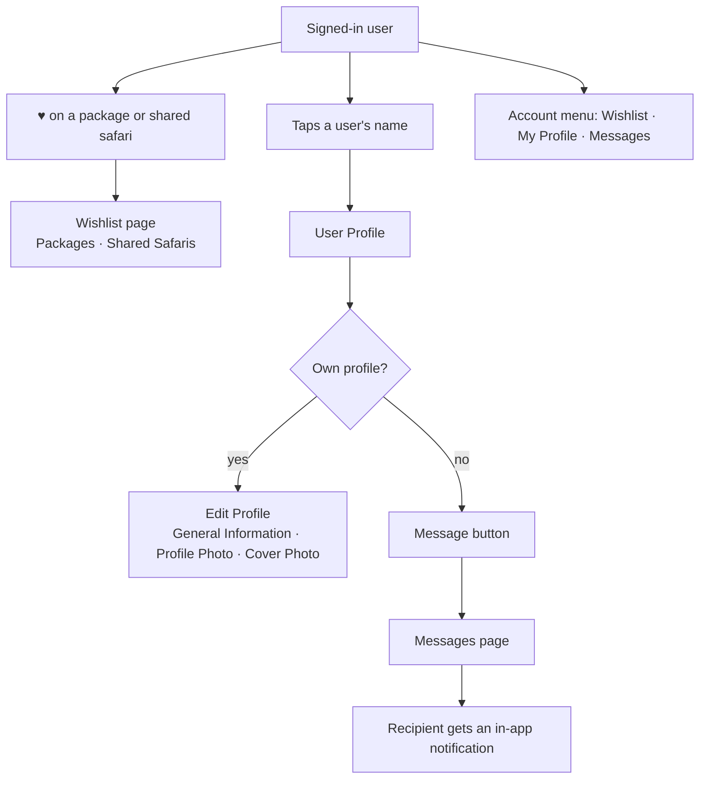

# Wishlist, Profiles and Direct Chat: the process

Four additions to the website: a **Wishlist** for saving packages and shared safaris, a public **Partner Profile**, a public **User Profile**, and **Direct Chat** between users. They build on Shared Safari and on the Packages feature.

**Status: in sync with the requirements** (`WITW-Profiles-Wishlist-Chat-Requirements.docx`) and the user's answers of **2026-11-20**. Every rule here comes from the requirements or from those answers (marked *(user, 2026-11-20)*). Nothing else has been added. Points still unclear are **not** written as workflow: they are listed as questions in §9 and stay out of the flows until answered.

**App:** Website (plus one link in the Partner portal).
**Who appears:** Guest · signed-in user · Partner.

## What this feature adds

| Area | What is added |
|---|---|
| Wishlist | A **♥** on package cards, the package page and the shared safari page; a **Wishlist** page with tabs **Packages** and **Shared Safaris** |
| Partner Profile | A public page for each active partner, with tabs **Packages** and **Parks** |
| User Profile | A public page for each user, with tabs **Profile** and **Shared Safaris**; **Edit Profile** for the user's own |
| Direct Chat | **Message** on a profile; a **Messages** page; an in-app notification for each new message |
| Account menu | **Wishlist**, **My Profile**, **Messages** |
| Partner portal | **Business Profile** gets a **View public page** link |

## The whole flow at a glance

```
 ♥ on package card / package page / shared safari page
        │  add or remove (signed-in users)
        ▼
   WISHLIST page  (Packages · Shared Safaris)


 Business name on a package page ─┐
 Business name on a partner's     ├──▶ PARTNER PROFILE  (header · Packages · Parks)
 comment or reply                 │
 Partner portal › Business        │
 Profile › View public page ──────┘

 A user's name anywhere on the website ──▶ USER PROFILE  (header · Profile · Shared Safaris)
   (a partner's name opens the Partner Profile instead)
        │
        ├─ not signed in ........ header only, "Please sign in to view the full profile."
        ├─ signed in, someone else's ... full profile + MESSAGE button
        └─ own profile ........... EDIT PROFILE button

 MESSAGE ──▶ first message creates the conversation ──▶ MESSAGES page
                                                        └─ each new message ──▶ in-app notification to the recipient
```

## The flow per person

### A. Guest (not signed in)

- Tapping the **♥** takes the guest to the **Login page**. After logging in, the guest comes back and must **tap the ♥ again** to add the item; it is not added automatically *(user, 2026-11-20)*.
- On a **User Profile** only the header is shown. Every tab shows "Please sign in to view the full profile." with a **Sign in** button, which brings them back to the profile.
- On **Direct Chat**, a guest is asked to sign in.

### B. Signed-in user



### C. Partner

- Partners have **no wishlist** and **don't use Direct Chat**.
- In the Partner portal, **Business Profile** has a **View public page** link to the Partner Profile.

---

## 1. Wishlist

A signed-in user saves packages and shared safaris to come back to later.

- **Who:** signed-in users only. A guest who taps the heart is asked to sign in. Partners have no wishlist.
- **The heart (♥)** shows on package cards, on the package page and on the shared safari page. Tapping it adds or removes the item, with a message:

| Item | Added | Removed |
|---|---|---|
| Package | "You added the Package to your wishlist!" | "You removed the Package from your wishlist!" |
| Shared Safari | The same message for a Shared Safari | The same message for a Shared Safari |

- **What can be saved:**
  - a package, **while it is shown on the website** (Packages requirement §6);
  - a shared safari, **while it is Active or Seat full and hasn't started**.
- **A host can add their own shared safari** to their wishlist *(user, 2026-11-20)*.

### 1.1 Wishlist page

Account menu › **Wishlist**.

| Element | Rule |
|---|---|
| Tabs | **Packages** (the default) · **Shared Safaris** |
| Cards | The usual cards |
| Order | **Newest saved first** |
| Paging | **Load More**, **6 items** at a time *(user, 2026-11-20)* |
| Empty | "No Packages available" · "No Shared Safaris available" |

### 1.2 When a saved item changes

- A package that is **no longer shown on the website drops out** of the wishlist. If it is shown again with **everything on its card the same**, it **comes back** into the wishlist; if its **price changed**, it **does not** come back *(user, 2026-11-20)*.
- A saved shared safari **stays in the list whatever its status**.
- There is **no limit** on the number of saved items.

## 2. Partner Profile

Each **active** partner has a public page on the website.

- **Opens from:**
  - the partner's **business name on the package page**;
  - the **business name on any comment or reply a partner writes** (Packages requirement §1.1);
  - the partner's name anywhere a user name would open a User Profile (§3);
  - Partner portal › Business Profile › **View public page**.

| Part | Content |
|---|---|
| Header | **Logo** · **business name** · **About your business** · count tiles **Packages** and **Parks** (tapping a tile opens its tab) |
| Tab **Packages** | The partner's packages **shown on the website**, as package cards |
| Tab **Parks** | The partner's **active** parks, as park cards |
| Paging | Each tab shows **12 at a time** with **Load More** |
| Empty | "No packages available" · "No parks available" |

- **Inactive partner, or an unknown link:** goes to the **home page**.
- The partner's **phone and email are not shown**.

## 3. User Profile

Each user has a public profile page.

- **Opens from:** a user's name anywhere on the website: the host name on shared safari cards and the safari page, comment and reply authors, and the Interested list. A partner's name opens their **Partner Profile** instead (§2).

| Part | Content |
|---|---|
| Header | **Cover photo** · **profile picture** · **name** |
| Tab **Profile** | **Bio** · **About** · social links: **Facebook, X, Instagram, YouTube** |
| Tab **Shared Safaris** | The safaris the user **organised** and the ones they **joined**, **shown on the website**: only those that are **active on the website now** *(user, 2026-11-20)* |

| Viewer | What they see |
|---|---|
| Not signed in | **Only the header.** Every tab shows "Please sign in to view the full profile." with **Sign in**, which brings them back to the profile |
| Signed in, someone else's profile | The **full profile** and a **Message** button (§5) |
| Own profile | An **Edit Profile** button |
| Inactive or unknown user | Goes to the **home page** |

- The user's **email and mobile are never shown**.

### 3.1 Edit Profile

Account menu › **My Profile**, or **Edit Profile** on their own profile. Three tabs:

| Tab | Field | Required | Rules |
|---|---|---|---|
| General Information | Name | Yes | Up to 100 characters |
| | Date of birth | Yes | Not in the future; 18 or older |
| | Gender | Yes | Male · Female · Other |
| | Bio | No | Text; a few short things about the user. **No length limit** |
| | About | No | Text; everything about the user, in detail. **No length limit** |
| | Facebook, X, Instagram, YouTube | No | Links; **no other check** than the requirements give *(user, 2026-11-20)* |
| Profile Photo | Photo | No | JPG, JPEG or PNG, up to **250 KB** |
| Cover Photo | Photo | No | JPG, JPEG or PNG, up to **500 KB** |

- A user's picture, once set, **replaces their initials everywhere on the website**.
- **Saving:** the user can fill **one tab and save it** on its own *(user, 2026-11-20)*.
- **Photos can be removed.** With no photo, a **dummy (placeholder) image** shows for the profile picture and for the cover photo *(user, 2026-11-20)*.
- **Existing users** without a date of birth or gender: nothing is asked of them for now *(user, 2026-11-20)*.

## 4. Notifications

- Each new direct message sends the recipient an **in-app notification on the website**.
- **Unread count:** the unread count is shown *(user, 2026-11-20)*.

## 5. Direct Chat

Signed-in users send each other private messages.

- **Who:** signed-in users only. **Partners don't use Direct Chat.** A guest is asked to sign in.
- **Starting a chat:** **Message** on another user's profile (§3). The conversation is created by the **first message**. Two users have **one** conversation.
- **Messages are text only;** an empty message can't be sent. No photos or files.
- Opening a conversation **marks its messages as read**.
- Messages and conversations **can't be edited or deleted**.
- **New messages arrive live** (without refreshing) *(user, 2026-11-20)*.
- **Maximum message length:** **1,000 characters**. The user left this to Claude's judgement, so it is **not confirmed by the client** *(chosen 2026-11-20)*.
- **Deactivated account:** its conversations **stay**. If someone sends a message to it, they are shown that the **account is deactivated** *(user, 2026-11-20)*.

### 5.1 Messages page

Account menu › **Messages**.

| Side | Content |
|---|---|
| **Left** | The conversations, **latest message first**: the other user's **picture and name**, the **start of the last message** (the first **50 characters**, then an ellipsis "…") and its **date and time** *(user, 2026-11-20)* |
| **Right** | The open conversation, with a **Type a Message** box and **Send** |

## 6. Screens

| New | Changed |
|---|---|
| Wishlist page | Package cards and package page (♥; the partner's business name links to the profile) |
| Partner Profile | Shared safari page (♥) |
| User Profile | Every user name on the website (opens the profile) |
| Edit Profile | Account menu (Wishlist, My Profile, Messages) |
| Messages | Business Profile in the Partner portal (View public page) |

## 7. Reference

| Item | Value |
|---|---|
| Gender | Male · Female · Other |
| Social links | Facebook · X · Instagram · YouTube |
| Wishlist tabs | Packages (default) · Shared Safaris |
| Partner Profile tabs | Packages · Parks |
| User Profile tabs | Profile · Shared Safaris |
| Edit Profile tabs | General Information · Profile Photo · Cover Photo |
| Partner Profile page size | 12, with Load More |
| Wishlist page size | 6, with Load More |
| Conversation list, last message | first 50 characters, then "…" |
| Chat message maximum | 1,000 characters (not confirmed by the client) |

## 8. Console

The requirements add nothing to the Console.

## 9. Still unclear (questions, not workflow)

These are **not answered** yet, so the flows above say nothing about them.

| # | Question |
|---|---|
| 1 | A saved shared safari that later becomes Seat full, not Active, started or over stays in the Wishlist. Can the user **remove it themselves** with the heart, or does it stay and can't be removed? |
| 2 | A package that comes back to the wishlist needs "everything on the card the same". Does **any** change on the card (name, image, tag, activity line, price message, Best deal) stop it coming back, or only a change of **price**? Which price: price per person, the struck-out price, or the total price? |
| 3 | **Deactivated account:** the requirements send an inactive user's profile to the **home page**, and the Shared Safari workflow hides a deactivated user's comments and safaris. The answer says their "history" is shown. Which history exactly, and does the profile page still open? |
| 4 | **Partner:** their User Profile and My Profile stay. What happens to the **wishlist** and **conversations** they had before becoming a partner (partners have no wishlist and don't use chat)? |
| 5 | **Error messages** for Edit Profile and for the chat: not confirmed yet |
| 6 | **Notification text** for a new message: not given. Please confirm the wording |
| 7 | **Message maximum of 1,000 characters:** please confirm this number with the client |
