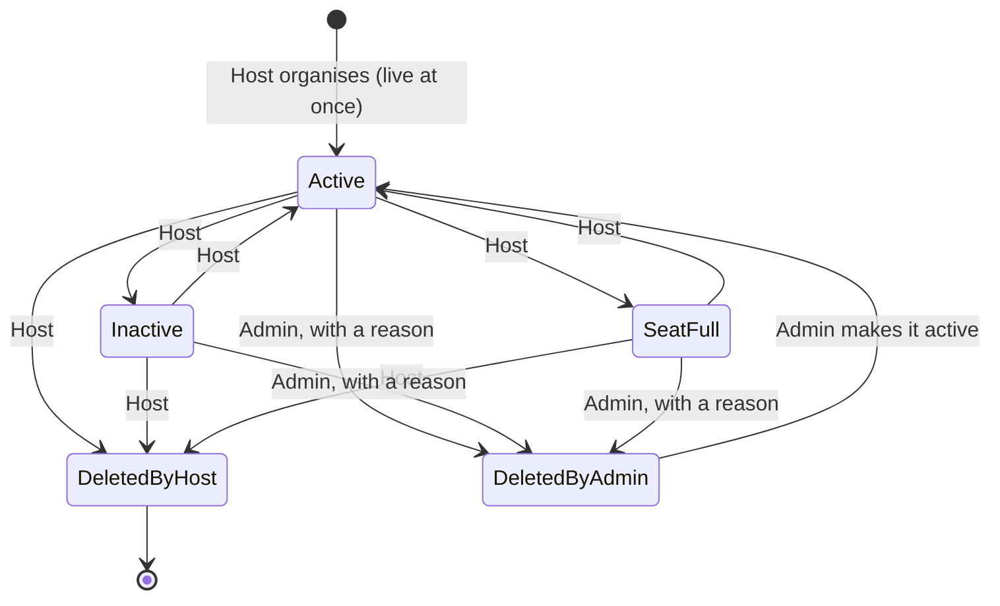
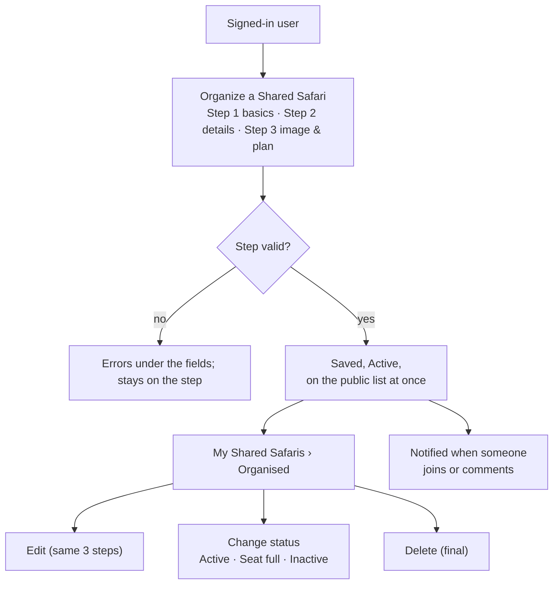
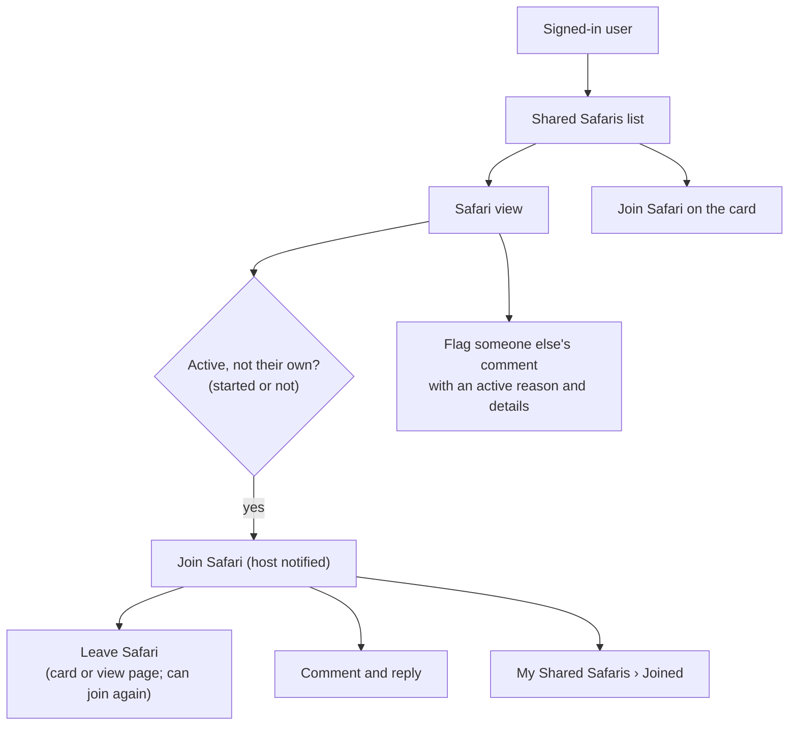
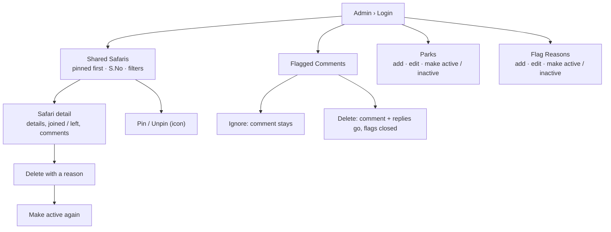

# Shared Safari: the process

A signed-in user plans a safari in a park and offers spare seats to other wildlife lovers. Others find it, show interest by joining, and talk in its discussion. Nothing is paid in the app and nothing waits for approval: a safari is live as soon as it's saved. In the console, the admin keeps things clean. The admin can delete a safari with a reason, make it active again, pin it, handle flagged comments, and manage the park list and the flag reasons.

**Status: updated to match the prototype** (`starter-prototype.html`, 4 Nov 2026), plus the decisions made after it (§13). Where a decision differs from the prototype, the prototype change is listed in [the Shared Safari prototype changes](../../planning/prototype-changes/2026-11-04-shared-safari.md).

**Roles:** Host, Member, Guest, Admin.

## What changed since the first version

| Area | Before | Now |
|---|---|---|
| Accounts | Sign in only | **Sign Up** page added (Full Name, Email, Mobile Number, Password) |
| Website entry | Starter Welcome / Dashboard | Portal opens **Shared Safaris** directly; Welcome and Dashboard pages removed |
| Organise form | One long form | **3-step dialog** "Organize a Shared Safari" / "Edit your safari" |
| Field names | Purpose · Stay | **Theme** · **Stay Category** |
| Organise button | Shown to everyone | Shown **only when signed in** |
| List filters | Search, park, month, price, safaris, purpose, stay | Search removed; **sliders** for budget and total safaris |
| Safari card | Dates, theme, price on card | Removed from card. Button: **Join / Leave / View / Seat Full** |
| Seat full | Others could still join | **No new joins**; members already joined stay and can leave |
| View page | Breadcrumb layout | Live WITW layout: details panel, **Discussion**, **Interested** box and popup |
| Who joined | "Who joined" list | Renamed **Interested**: initials only, popup with S.No / Name / Joined On |
| Actions menus | ⋯ menu | **Icon buttons** with tooltips, everywhere |
| Console look | Starter console | **WITW header and logo**. Opening Console from the website shows **Login** first |
| Console › Parks | Read-only | **Add, Edit, Make active / inactive**; the Organise form and the list's Safari Park filter both use the active parks |
| Flag reasons | Fixed list | **Flag Reasons master** in the console |
| Console tables | — | **S.No** column, **Clear filters**, alternate row colours |
| Pin | Menu item | **Pin icon in Actions**: filled = pinned, outline = not pinned |

## The whole flow at a glance

```
            Admin (console)                              Website
            ───────────────                              ───────
    Parks (add / edit / active) ── active parks ──▶  HOST organises a safari (3 steps)
    Flag Reasons (add / edit / active)                        │  live at once
                     │                                        ▼
                     │                             SHARED SAFARIS list ◀── GUEST browses,
                     │                             (filters, sort)          filters, views
                     │                                        │
                     │                                        ▼
                     │                               SAFARI VIEW PAGE
                     │                              ┌─────────┴──────────┐
                     │                              ▼                    ▼
                     │                     MEMBER joins / leaves     Discussion
                     │                     (host notified)           (host + members, also
                     │                              │                 those who left; host notified)
                     │                              ▼                    │
                     │                     Host marks "Seat full"        ▼
                     └── active reasons ──────────────────────▶ Signed-in user flags a comment
                                                                         │
    Shared Safaris: delete with reason,  ◀───────────────────────────────┘
    make active, pin · Flagged Comments: ignore or delete
```

## The life of a safari



A safari whose start date has passed is **over** (started). Being over is **not** a status: the safari stays on the public list, and people can still join, leave and comment (#33, #44, #45). Once its **end date** has passed it **leaves the public list**, but its page still opens from its link (#47). My Shared Safaris marks it "Over"; no background job is involved.

**Dates and time:** "today", "started" / "over" and every date limit are counted in **Indian time (IST)**.

## The flow per role

### A. Host



### B. Member (signed in, not the host)



### C. Guest (not signed in)

- **Browsing:** a guest can browse the list, use the filters, open a safari, read the discussion and see who is interested, including the **Interested popup with the Joined On dates**.
- **Joining:** **Join Safari** takes the guest to Login.
- **Organising:** the **Organize a Shared Safari** button is not shown to guests.
- **Account icon:** the account icon in the header opens Login. Login links to **Sign Up**, and Sign Up links back to Login.

### D. Admin (console)



---

## 1. Who can do what

| Action | Guest | Signed-in user | Host (own safari) | Member (joined) | Admin |
|---|---|---|---|---|---|
| Browse, filter, view, read discussion, see Interested | ✓ | ✓ | ✓ | ✓ | |
| Sign up / log in | ✓ | | | | |
| Organise a safari | | ✓ | | | |
| Edit, change status, delete | | | ✓ | | |
| Join / leave | | ✓ | ✗ | ✓ | |
| Comment and reply | | | ✓ | ✓ (joined now, or joined before and left) | |
| Flag a comment | | ✓ (not their own) | ✓ | ✓ | |
| Delete with reason, make active, pin | | | | | ✓ |
| Delete a comment, handle flags | | | | | ✓ |
| Parks, Flag Reasons (add, edit, status) | | | | | ✓ |

- **Host** is not a role given to anyone: a user is the host of the safaris they organised.
- The **Admin** is the console's Super Admin, working in the console only.

## 2. Accounts

| Page | Fields | Rules and messages |
|---|---|---|
| **Login** | Login ID (mobile no. or email), Password | Existing rules. Link: "Don't have an account? **Sign Up**" |
| **Sign Up** | Full Name, Email, Mobile Number, Password (show / hide) | All required. Errors: "Enter your full name." · "Enter a valid email address." · "An account with this email already exists." · "Enter a 10-digit mobile number." · "An account with this mobile number already exists." · "Use at least 8 characters." Link: "Already have an account? **Login**" |

- **Mobile number:** 10 digits starting 6–9, unique, the same rule as everywhere else in the app. The user can then log in with the email or the mobile number.
- **No role:** Sign Up gives the new user **no role**. A website user only needs an account to sign in; Host and Member come from what they do (§1), not from a role. The console stays closed to them.
- After signing up, the user is **signed in at once** and lands on Shared Safaris with "Welcome, {first name}! Your account is created."
- **No email verification or sign-up limit:** an account works as soon as it is created; there is no verification email and no limit on how many sign-ups are allowed.
- **Forgot Password** (website and console): the reset email is **only captured in the mail log**, never sent. It is recorded with status "Captured (not sent)" and shown in Console › Notifications › Delivery Log (the existing `EMAIL_DRIVER=capture`).
- Opening **Console** from the website always shows the console **Login** first.

## 3. Parks

Parks are **master data**. The 55 Walk Into The Wild parks arrive with the feature's migration (`2026-11-04-shared-safari.sql`, table `master_park`), and the admin now maintains them in the console.

### 3.1 What a park holds

| Field | Example | Notes |
|---|---|---|
| Name | Bandhavgarh Tiger Reserve | Required, unique |
| Slug | `bandhavgarh-tiger-reserve` | Made from the name when added; set once |
| Region | Central India | Required: North, Central, West, East, South, North East India |
| Average safari price, min – max | ₹3,500 – ₹4,500 | Per safari, whole rupees **up to ₹10,00,000** (the same limit as a safari's price per person); both or neither; max not less than min |
| Short description, feature image, latitude / longitude, website | — | From the starting data; shown on the park detail |
| Status | Active | Only **active** parks are offered in the Organise form |

### 3.2 Console › Parks

| Element | Detail |
|---|---|
| Columns | S.No · Park · Region · Avg. safari price · Upcoming safaris (Active and Seat full safaris starting today or later) · Status · Actions |
| Filters | Park name search · Region · Status (All / Active / Inactive) · **Clear filters** (shown when a filter is set) |
| Actions (icons) | **Edit** (pencil) · **Make active / Make inactive** (switch icon) |
| Add Park | Button at the top. Form: Park name, Region, Min. and Max. safari price. A new park is Active |
| Edit Park | Same form plus a **Status switch** (Active / Inactive), shown only when editing |
| Park detail | All fields, upcoming shared safaris, **Edit** and **Make active / inactive** buttons |

- **Inactive park:** hidden from the Organise form and the website's Safari Park filter. Safaris already planned there are not affected. When the host **edits** such a safari, the park field still shows its current park, but they must **pick an active park again** before the safari saves.
- **Added park:** appears at once in the Organise form and the Safari Park filter.
- **Errors:** "Enter the park name." · "A park with this name already exists." · "Select a region." · "Max. price must be at least the min. price." · "Enter both prices, or leave both empty." · "Enter whole rupees, up to ₹10,00,000."
- **Paging:** 20 per page, with alternate row colours.

## 4. Organising a safari

Website › Shared Safaris › **+ Organize a Shared Safari** (signed in only). A 3-step dialog, which opens as a bottom sheet on mobile. **Edit** uses the same steps, titled "Edit your safari".

| Step | Field | Required | Rules |
|---|---|---|---|
| 1 | Title | Yes | Up to 255 characters. "Enter a title." · "Use up to 255 characters." |
| 1 | Select a Safari Park | Yes | Searchable list of **active** parks, A–Z. "Select a park." |
| 1 | Start Date · End Date | Yes | Start from today up to one year ahead; end after start. "Enter a start date." · "Choose a start date from today up to one year ahead." · "Enter an end date." · "End date must be after the start date." |
| 1 | Number of Safaris | Yes | 1 to 10 game drives. "Enter the number of safaris." · "Enter a number from 1 to 10." |
| 2 | **Theme** | Yes | Photography · Safari Experience. "Select a theme." |
| 2 | Total Seats · Seats to Share | Yes | Total 2 to 6 (host included); seats to share at least 1 and fewer than total. "Enter the total seats." · "Enter a number up to 6." · "Enter the seats to share." · "Enter at least 1 seat." · "Seats to share must be fewer than the total seats." |
| 2 | Price Per Person, from – to | Yes | Whole rupees, **from ₹0** up to 10,00,000; "to" not less than "from". "Enter the price per person, from and to." · "Enter whole rupees, up to ₹10,00,000." · "The “to” price can't be less than the “from” price." |
| 2 | **Stay Category** | No | "Select a Stay Category": Premium, Standard, Economical, Not Included, Forest Rest House, Home Stay |
| 3 | Display image | No | **PNG, JPG or JPEG**, up to **5 MB**; without one, the default WITW cover is shown. Saved locally in the storage bucket folder (below). "Use a PNG, JPG or JPEG image." · "Use an image up to 5 MB." |
| 3 | Safari Plan | Yes | **Fewer than 1,000 words** (999 at most; words are the text split at spaces). "Enter a safari plan." · "Please provide content within 1000 words." |

- **Where images are kept:** a safari's display image is saved **locally**, by the app's local file storage (`STORAGE_DRIVER=local`), at `shared_safari/<safari id>/cover_image/<file>` under the storage folder (`storage/` at the repo root, never in git), as every upload ([file storage](../platform/file-storage.md)). The safari keeps only the file's name; replacing the image on Edit replaces the file. Images are kept **as uploaded, not resized**. Safari photos are the ones **hosts upload**; the app adds no sample photos.
- **Moving between steps:** **Next** checks the current step, **Back** keeps what was entered, and **Cancel** closes the dialog. Dots show the current step.
- **Create:** the safari becomes **Active**, appears on the public list at once, and the host lands on its view page with "Your safari is live."
- **Save changes:** joined members and comments are kept. The safari's link never changes.
- **When the host can edit:** at any time. Editing is not bounded by the start date or the end date: a safari that has started or is over can still be edited, from My Shared Safaris › Organised.
- **Dates on Edit:** the start-date rule (from today up to one year ahead) is checked **only when the start date is changed**. An unchanged start date in the past is kept. "End date must be after the start date." is always checked.

## 5. Statuses

| Status | Set by | Public list and view | New joins | Comment |
|---|---|---|---|---|
| **Active** | Saving; host; admin | Shown | ✓ | ✓ |
| **Seat full** | Host | Shown; card strip turns grey | **✗** (Join hidden; members already joined can leave) | ✓ |
| **Inactive** | Host | Hidden; "This safari is not available." (the host sees the page, below) | ✗ | ✗ |
| **Deleted by host** | Host (final) | Hidden | ✗ | ✗ |
| **Deleted by admin** | Admin, with a reason | Hidden | ✗ | ✗ |

- **Host's choices:** Active, Seat full, Inactive, or **Delete this safari**. Delete asks "Delete this safari? This can't be undone."
- **Started safari:** a safari whose start date has passed works like any other: it **stays on the public list**, people can **join and leave** (§7) and **comment** (§8). Whether its view page shows a "This safari has already started." note is a UI detail that follows the prototype (#29).
- **Seat full** is never set automatically.
- **Host's own Inactive safari:** the host sees its view page the same as any of their other safaris (with the status badge and their Update Safari and Change Status buttons). It is reached **only from My Shared Safaris › Organised**, since it isn't on the public list. Everyone else gets "This safari is not available."
- **Deactivated host:** when the host's account is deactivated, all their safaris are hidden from the website (lists and view pages, "This safari is not available."), whatever their status. Their statuses don't change; making the account active again shows them again. They are not in the members' **My Shared Safaris › Joined**, nor in the host's **Organised** tab. The console still lists them.
- **Deactivated member:** their comments, replies and flags are **not shown anywhere** while their account is deactivated. They are also left out of **Interested** (the initials, the popup) and out of every **joined count** (the card's "N joined", Interested – N).

## 6. Finding safaris

### 6.1 The list (website, public)

The page has the banner "Join or Organize a Shared Safari" and the line "There are currently **N** active shared safaris". **N** counts every safari the list shows: Active **and Seat full**. It shows every **Active** and **Seat full** safari, whether it has started or not, until its **end date has passed** (after that it is off the list, but its page still opens from its link), and more load as you scroll. A round **back-to-top** button appears after scrolling, and hides while a dialog is open.

**Card:**

| Part | Content |
|---|---|
| Picture | Cover with a date badge (e.g. "Mar 6"). All pictures are the same height |
| Green strip | Safaris **N** · Seats **X of Y** (grey when Seat full) |
| Body | Title · "{Host} has shared a safari" · park |
| Footer | Initials of who joined (+N) · "N joined" · button |

**Card button:**

| Viewer | Button | Action |
|---|---|---|
| Guest | Join Safari | Opens Login |
| Signed in, not joined | Join Safari | Joins: "You've joined this safari." |
| Joined | **Leave Safari** | Leaves: "You've left this safari." |
| Host | View Safari | Opens the view page |
| Seat full, not joined | Seat Full | Opens the view page |

**Filters ("Select Filters", behind a Filters button on mobile):**

| Filter | Values |
|---|---|
| Safari Park | Any / All, or one **active** park, A–Z. The list comes from Console › Parks, so parks added or made inactive there show up here at once |
| Month | January – December (safaris starting that month) |
| Budget Price Per Person | Slider ₹100 – ₹50,000+ ("+" means no upper limit) |
| Total Safaris | Slider 1 – 10+ |
| Theme | Photography · Safari Experience (checkboxes) |
| Stay Category | The six stay categories (checkboxes) |

- **Chips:** each chosen filter shows as a chip with a ✕, plus **Clear all**.
- **Sort:** Newest first (default) · Most safaris · Fewest safaris · Price low to high · Starting soonest · Starting latest. **Starting soonest / latest** order by the **start date**, started safaris included.
- **Month** is the month of the **start date**; started safaris on the list are included.
- **Empty states:** "No shared safaris match your filters." with Clear filters. With no safaris at all: "No shared safaris yet."

### 6.2 The view page (website, public)

| Section | Content |
|---|---|
| Banner | "Shared Safari" |
| Top | Picture · title · dates · park · "Organized by {host}" · status badge (non-active only) |
| Details | Trip Duration (N Nights, N Days) · Available Seats (share / total) · Safaris · Stay Category · Theme · Cost |
| Share row | "Share this safari with your friends:" with Facebook, X, Instagram, WhatsApp, LinkedIn, Telegram and copy-link icons (display only) |
| Buttons | Guest / not joined: **Join Safari** (hidden when Seat full) · Joined: "You've joined this safari." + **Leave Safari** · Host: **Update Safari** + **Change Status** |
| Safari Plan | Phone numbers and emails are hidden as `••••` for everyone; the host sees them in Edit |
| Discussion (N) | Comments and replies (§8) |
| **Interested – N** | Initials circles of members joined now (up to 8, then "+N"). Hover shows the name; the circles don't click |

- **Interested popup:** clicking the green **Interested** header opens a popup titled "INTERESTED (N)". It has a table (S.No · Name · Joined On) and the footer "Showing 1 - N of N interested users".
- **Who is shown:** the card, the Interested box and the popup show only the **current members** (joined now). Someone who left is not shown; if they join again they are shown again, and **Joined On** is their **last** join time.
- **Not available** (inactive, deleted or unknown link): "This safari is not available." with Back to Shared Safaris. The one exception is the host's own Inactive safari (§5).

## 7. Joining and leaving

| Rule | Message |
|---|---|
| Signed in | Guest → Login |
| Not the host | "You can't join your own safari." |
| Active, started or not (Seat full: no new joins) | "This safari is not open to join." |
| Already joined | The button says **Leave Safari** |

- **Join:** the member appears in Interested and the host is notified. Joining again after leaving doesn't notify the host again.
- **Leave:** on the view page it asks "Leave this safari?"; on the card it happens at once. Either way it shows "You've left this safari.".
- **Removing members:** the host can't remove a member. Joined and left times are kept.

## 8. Discussion, replies and flags

- **Who comments:** the host, members who are joined now, and members who joined before and left, while the safari is Active or Seat full, whether it has started or not.
  - Signed-in users who have never joined see "Join this safari to comment."
  - Guests see "Sign in and join this safari to comment."
- **No masking in comments (for now):** comments and replies are shown as written; phone numbers and emails in them are **not** hidden. Only the Safari Plan is masked (§6.2).
- **New comment:** the writer's initial and a text box, then **Post Comment**. Replies go under their comment through **Reply** and **Post Reply**.
- **Text:** required, **fewer than 200 words** (199 at most; words are the text split at spaces). "Enter a comment." · "Please provide content within 200 words." Shown oldest first.
- **After leaving:** a member's comments and replies **stay visible** after they leave, and they **can still post** new comments and replies.
- **Own comments:** the writer can **edit** and **delete** their own comment or reply. Editing uses the same text rules. A deleted comment is removed from the discussion, and **its replies are hidden with it**: no reply is shown under a deleted comment. Deleting a reply removes only that reply. **Flags on a deleted comment** (and on its hidden replies) **no longer show** in Flagged Comments. The **hidden replies** are not shown anywhere, to their writers or to the admin (not in Shared Safari detail either), and can't be edited or deleted. A writer **can edit a flagged comment**; Flagged Comments then shows only the **updated** text. The writer can edit and delete **also after the safari has started**. Once the writer has **left** the safari, they can no longer edit or delete their comments (they can still post new ones, see After leaving). An edited comment shows **no "edited" mark**, and a delete happens **at once, with no confirmation**.
- **Flag:** a **flag icon** on someone else's comment or reply opens "Flag this comment". It needs a reason and details, both required.
  - **Reasons:** the **active** reasons from the Flag Reasons master (§11.4), in the order they were added.
  - **Details:** required, up to **500 characters**. "Use up to 500 characters."
  - **Started safari:** comments on a safari that has started can still be flagged.
  - **Own comment:** "You can't flag your own comment."
  - **Any number of times:** a user can flag the same comment again, even while their earlier flag is open. Every flag counts in Flagged Comments.
  - **After flagging:** "Thanks, we'll review this comment." The comment stays visible until the admin deletes it.
- **Notifications:** the host is notified of every new comment or reply on their safari, except their own.

## 9. My Shared Safaris

Website › account menu › **My Shared Safaris** (signed in). The page has an **Organise a Safari** button at the top.

| Tab | Shows | Actions (icons) |
|---|---|---|
| **Organised** | The user's Active, Seat full and Inactive safaris, upcoming and past ("Over") | View · Edit · Change status · Delete (red) |
| **Joined** | Every safari the user is joined to now, whatever its status, **except Inactive and deleted** ones; upcoming and started, a started one marked "Over" (as in Organised) | View · Leave |

On mobile the action icons sit in their own row under each safari.

## 10. Notifications

In-app: in the header **mail icon** (its popover) and on the website's **Notifications** page (Web Notifications), newest first, unread marked.

| When | To | Text |
|---|---|---|
| Someone joins (first time) | Host | "{name} joined your safari {title}." |
| Someone comments or replies | Host | "{name} commented on your safari {title}." |

- Each opens the safari.
- These are the only Shared Safari notifications. The account notifications the website already has (account created, password changed) stay as they are.

## 11. Console

The console has the WITW header (dark green, WITW logo). The sidebar group **Shared Safari** holds Shared Safaris, Flagged Comments, Parks and Flag Reasons. Every Shared Safari list has an **S.No** column, alternate row colours, icon actions with tooltips, and **Clear filters** when a filter is set.

**Patterns, as the prototype:** each console screen looks the way its prototype board shows it. The Shared Safari screens use the patterns above (alternate row colours; the status switch inside Edit, not in the row). The existing console screens (Users, Languages and the rest) keep their own boards' patterns (plain rows, the status switch in the row).

### 11.1 Shared Safaris

| Element | Detail |
|---|---|
| Order | Pinned first, then newest |
| Columns | S.No · Title · Park · Host · Dates · Seats · Joined / left (each count opens its list) · Status · Actions |
| Filters | Title or park search · Status (**All** by default · Active · Inactive · Seat full · Deleted by admin · Deleted by host) · Host |
| Actions | **View** · **Pin** icon: filled green = pinned, outline = not pinned; click to toggle. Deleting a safari does **not** unpin it |
| Paging | 20 per page |

### 11.2 Shared Safari detail

- **Content:** everything on the view page, with the plan unmasked. It also lists who joined (with their last join time) and who left (one line per member, with their **last leave** time; no history of earlier joins and leaves), and every comment with its reply and flag counts. An admin-deleted safari shows its reason; a host-deleted safari shows "Deleted by host" with when it was deleted.
- **Host-deleted safari:** the admin can open and view it (details, joined / left, comments), read-only: no Make active, Pin or Delete.
- **Actions:**
  - **Delete:** asks for a reason from the fixed 8 (§11.4 starting list) and details. The safari becomes **Deleted by admin**.
  - **Make active:** brings an admin-deleted safari back to Active. A host-deleted safari can't be brought back.
  - **Pin / Unpin.**
  - **Delete a comment**, with its replies, or **delete a single reply** on its own.

### 11.3 Flagged Comments

| Element | Detail |
|---|---|
| Columns | S.No · Comment (with reasons; the comment's current text) · Safari · By · Flags · Actions. A comment deleted by its writer, or written by a deactivated user, isn't listed |
| Filter | Search comment or safari |
| Actions | **View flags** · **Ignore** (flags closed, comment stays) · **Delete** (comment and replies removed, flags closed) |

### 11.4 Flag Reasons (new)

| Element | Detail |
|---|---|
| Columns | S.No · Reason · Used in flags (every flag ever made with it, open or closed) · Status · Actions |
| Filters | Reason search · Status (All / Active / Inactive) |
| Actions | **Edit** · **Make active / Make inactive** |
| Add Reason | Reason only (up to 60 characters). A new reason is **Active** |
| Edit Reason | Reason plus a **Status switch** (Active / Inactive), shown only when editing |
| Order | The order they were added; there is no separate sort order and no reordering (a new reason comes last) |
| Starting reasons | Abusive or Illegal · Commercial or Spam · Dating / Sexually Explicit · Felt Unsafe · Shows My Private Information · Violates Guidelines · Off Topic · Other |

- **Errors:** "Enter the reason." · "This reason already exists." (not case-sensitive).
- **Inactive reasons** are hidden from the website's Flag dialog. Past flags keep their reason. Renaming a reason doesn't change past flags.

### 11.5 Parks

See §3.2.

### 11.6 Audit

Every admin action is recorded in the Audit Log: delete, make active, pin, flag handling, and park and reason add / edit / status changes.

## 12. Screens (prototype boards)

| Website | Console |
|---|---|
| Web Sign In · **Web Sign Up** · Web Forgot Password | Admin Sign In · Admin Forgot Password |
| W1 Shared Safaris list | C1 Shared Safaris list |
| W2 Safari card | C2 Joined / Left list |
| W3 Shared Safari view | C3 Shared Safari detail, Delete with reason |
| W4 Who joined (Interested popup) | C4 Flagged Comments |
| W5 Organise a Safari / Edit | C5 Parks list |
| W6 Change status · W7 Delete and Leave · W8 Flag a comment | C6 Park detail |
| W9 My Shared Safaris · Web Notifications · Web Not Found | **C7 Flag Reasons** |

Each screen has a desktop (1366 px) and a mobile (390 px) board. On mobile, dialogs open as bottom sheets and filters sit behind a button. Below 1280 px the list shows 2 cards per row, and below 900 px the layout stacks.

**Look:** the website and the console follow the prototype's WITW design system (its colours, corners, shadows and the Roboto font, loaded by the apps). The password-reset email uses the WITW colours, as in the prototype's email preview. Web Not Found keeps the existing page inside the WITW frame.

**Prototype first:** the prototype team fixes the prototype first, for the font and the sizes; the apps' fonts and sizes are based on the fixed prototype. **Re-theming comes first:** when the prototype is updated, the apps (existing screens included) are re-themed to follow its design system before the new screens are built, and again whenever the design system changes. Screens are built from a board once it is fixed and declared ready ([PROTOTYPE-SYNC](../../PROTOTYPE-SYNC.md)).

## 13. Decisions

| # | Point | Decision |
|---|---|---|
| 1 | Admin **delete reasons** for a safari | They stay as they are: the fixed 8 reasons, separate from the Flag Reasons master. |
| 2 | Parks added in the console | The website's **Safari Park** filter uses the console park list (active parks only), the same as the Organise form. |
| 3 | Share icons and the "Plan Safari" / "Safari Packages" menu | Display only. |
| 4 | ~~"Live" in Console › Shared Safaris~~ | ~~Only the label of the Status filter's default option (Active, not started), not a status.~~ Superseded by #55: "Live" is removed. |
| 5 | Host-deleted safaris in the console | The admin can find them (Status: Deleted by host) and view them, read-only; they can't be made active. |
| 6 | Editing a safari | The host can edit their safari at any time, not bounded by its start or end date. |
| 7 | Members on the website | The card and the view page (Interested box and popup) show only current members, with their last join time as Joined On. |
| 8 | Word limits | As the prototype: fewer than 1,000 words in the plan and fewer than 200 in a comment (999 / 199 at most). |
| 9 | Flagging twice | A user can flag the same comment any number of times. |
| 10 | Console Left list | One line per member with their last leave time; no join / leave history. |
| 11 | Dates when editing | The start-date rule is checked only when the start date is changed; end after start is always checked. |
| 12 | Sign Up | Adds a Mobile Number field (required, unique, 10 digits). No role is given: a website user only needs an account. |
| 13 | Flag reasons table | Stays `master_flag_reason`. |
| 14 | Web Notifications | Shows the two Shared Safari notifications with the existing account ones; the prototype's other sample notifications are not part of this feature. |
| 15 | Host-deleted safari in the console | Read-only. |
| 16 | Comments after leaving | Stay visible, and the member can still post new comments and replies after leaving. |
| 17 | Own comments | The writer can edit and delete their own comment or reply. Deleting a comment hides its replies too. |
| 18 | Deactivated host | All their safaris are hidden from the website. |
| 19 | Theme, font and email | As the prototype: the WITW design system, Roboto loaded by the apps, and the reset email in WITW colours. |
| 20 | Forgot Password email | Only captured in the mail log (Delivery Log, "Captured (not sent)"); no email is sent. |
| 21 | Safari images | Saved locally by the app's file storage at `shared_safari/<safari id>/cover_image/<file>` (the file name only in the database); PNG, JPG or JPEG, up to 5 MB. |
| 22 | Host's own Inactive safari | The host sees the page as for their other safaris; it is reached only from My Shared Safaris. Others see "This safari is not available." |
| 23 | Phone numbers and emails in comments | Not masked for now; only the Safari Plan is masked. |
| 24 | Console UI patterns | As the prototype: each screen as its board. The Shared Safari screens use alternate rows and the status switch in Edit; the existing screens keep their own patterns. The prototype decides the patterns; when it changes them on other boards, those screens follow. |
| 25 | Own comments after the start | The writer can edit and delete their comment or reply also after the safari has started. |
| 26 | Edited mark and delete confirmation | Neither: no "edited" mark; deleting your own comment or reply happens at once. |
| 27 | Image resizing | None: images are kept as uploaded (PNG, JPG or JPEG, up to 5 MB). |
| 28 | Prototype fixes before building | The prototype team fixes the prototype first (font and sizes); the apps follow the fixed prototype. |
| 29 | UI details (where a page lands after an action, confirmations, wording and spelling, filter options on existing screens) | Follow the prototype as it arrives; the boards decide them. |
| 30 | The Devator Exp font | The prototype team handles the font (its files and licence); the apps use what the prototype uses. |
| 31 | "N active shared safaris" | Counts Active and Seat full safaris (every safari on the list). |
| 32 | Editing a safari whose park is now inactive | The form shows the current park; the host must pick an active park again to save. |
| 33 | Joining and leaving a started safari | Allowed: anyone can join or leave whether the safari has started or not (Seat full still stops new joins). |
| 34 | Flagging on a started safari | Allowed. |
| 35 | Flag details | Required, up to 500 characters. |
| 36 | "Used in flags" | Counts every flag ever made with the reason, open or closed. |
| 37 | Flag reason order | No separate order: the order they were added; no reordering. |
| 38 | Admin deletes a single reply | Allowed, on its own; deleting a comment still removes its replies. |
| 39 | Sign Up verification and spam protection | None. |
| 40 | Time zone | "Today", started / over and the date limits are in Indian time (IST). |
| 41 | A park's "Upcoming safaris" | Active and Seat full safaris starting today or later. |
| 42 | Deleting a pinned safari | It stays pinned. |
| 43 | Own comments after leaving | The writer can't edit or delete their comments after they left (they can still post new ones). |
| 44 | A started safari on the public list | It stays on the list (started or not, Active and Seat full are shown). |
| 45 | Comments on a started safari | Allowed, as on any other safari. |
| 46 | My Shared Safaris › Joined | Shows all the safaris the user is joined to now (Active and Seat full), upcoming and started. |
| 47 | After the end date | The safari leaves the public list; its page still opens from its link. |
| 48 | Sort and Month with started safaris | Based on the start date (Starting soonest / latest; Month = the start date's month). |
| 49 | Flags on a comment its writer deletes | They no longer show in Flagged Comments (with the flags on its replies). |
| 50 | Editing a flagged comment | Allowed; Flagged Comments shows only the updated text. |
| 51 | Deactivated host's safaris in My Shared Safaris | Not shown: not in members' Joined, nor in the host's Organised. |
| 52 | Deactivated member | Their comments, replies and flags are not shown anywhere. |
| 53 | Replies hidden under a deleted comment | Not shown anywhere, to their writers or the admin; no edit or delete. |
| 54 | Deactivated member in Interested and counts | Left out of Interested and of every joined count. |
| 55 | Console Shared Safaris status filter | "Live" is removed; the filter is All by default, with Active, Inactive, Seat full, Deleted by admin and Deleted by host. |
| 56 | Image and flag-details messages | "Use an image up to 5 MB." · "Use up to 500 characters." |
| 57 | My Shared Safaris › Joined | Every joined safari whatever its status, except Inactive and deleted ones; a started one is marked "Over". |
| 58 | Display image types | PNG, JPG and JPEG; a wrong type gets "Use a PNG, JPG or JPEG image." |
| 59 | Guests and the Interested popup | Guests see it, with the Joined On dates. |
| 60 | Safari photos | Hosts upload their own; the app adds no sample photos. |
| 61 | Re-theming | First step: when the prototype is updated, re-theme the apps (existing screens too) to its design system before building new screens, and follow it whenever it changes. |
| 62 | A park's average safari price | Up to ₹10,00,000, the same limit as a safari's price per person ("Enter whole rupees, up to ₹10,00,000."). |
| 63 | Minimum price per person | ₹0 is allowed (whole rupees from ₹0 up to ₹10,00,000). |
